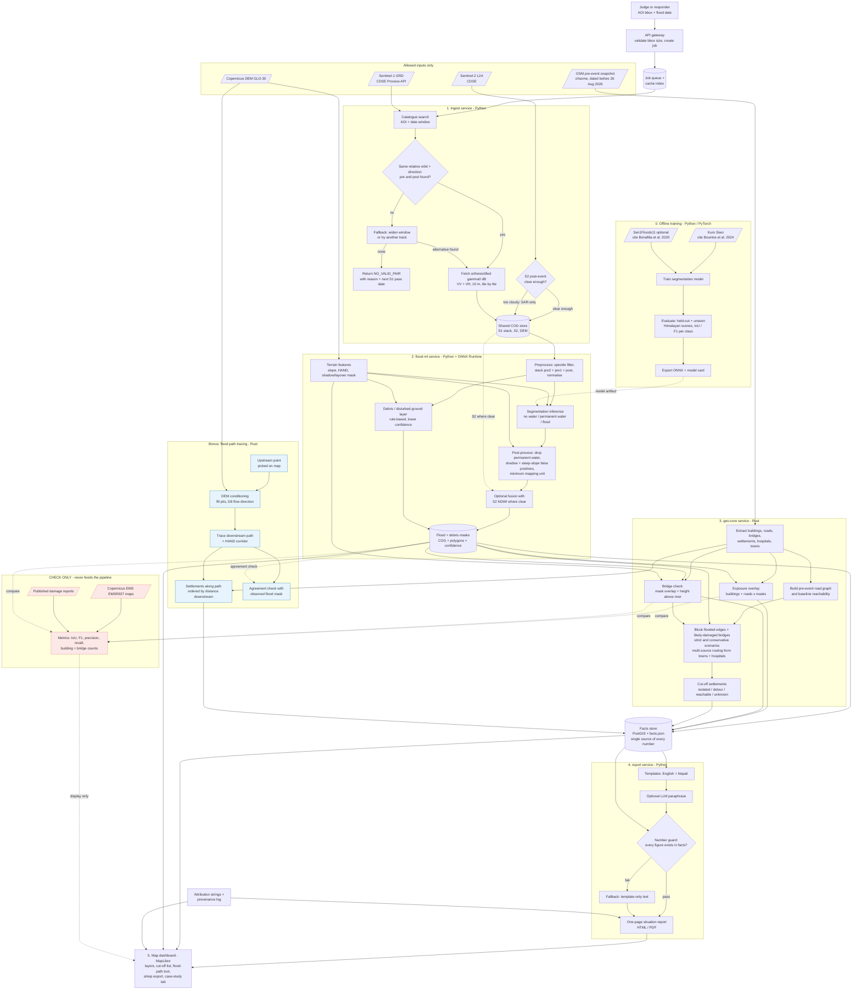
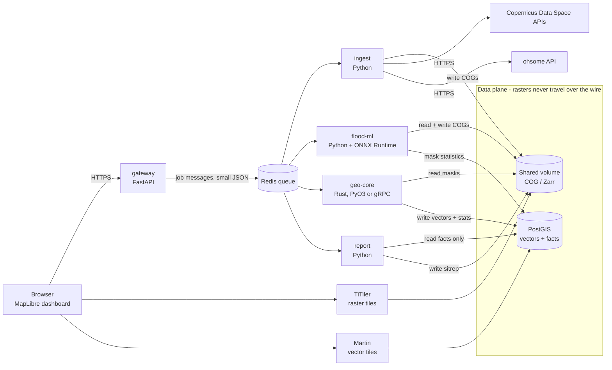

# AGENT BRIEF: Himalayan Flood Response Prototype (Multimodal AI Hackathon 2026, Track B)

## 0. How to work with this document

You are the lead engineer building this system. Read the whole document before writing code.

1. **Verify before you rely.** Every external API, endpoint, library version and licence named here comes from a research pass, not from your own execution. Check current official documentation before coding against it. Never invent endpoints, parameters or crate/package names. If something does not work as described, record it in `DECISIONS.md` and propose an alternative.
2. **Work in the milestone order in section 9.** Always keep a runnable end-to-end path. A simple baseline that works beats an advanced model that does not run.
3. **Do not fabricate numbers.** Every figure shown to a user comes from the pipeline's `facts.json` (section 5). Never hardcode casualty counts, areas or results.
4. **Ask before deviating** from section 2 (hard rules). Everything else is a recommendation you may change with a note in `DECISIONS.md`.
5. Keep commits small. Write tests with each module. Keep `README.md` runnable from a clean machine.

## 1. Mission and scoring

Build a system that takes **an area (bbox) and a flood date** and, from satellite data only, answers:

1. **Where did the flood hit?** Flooded and debris-covered areas, from before/after comparison. Sentinel-1 radar is primary; Sentinel-2 optical is used only when clear.
2. **What was damaged?** Buildings, roads and bridges from the pre-event OpenStreetMap snapshot, intersected with the hazard mask.
3. **Who is cut off?** Settlements that lost their road connection to the nearest town or hospital.
4. **AI component (chosen: flood segmentation model).** Train on listed datasets and report performance on Himalayan scenes the model has never seen.
5. **Bonus:** from any upstream point, trace the flood path down the valley using the DEM and list settlements along it.
6. **Case study:** the 26 August 2026 Bhote Koshi - Trishuli flood, compared against Copernicus EMS activation EMSR927.

Judges run the system **live on areas and dates they choose**. Scoring weights: flood and damage mapping 30%, AI component 25%, cut-off analysis 20%, report/Q&A/honesty about limitations 15%, dashboard and situation report usability 10%.

Primary users are **rescue teams** (mostly government agencies). Affected communities are a secondary audience reached through a printable, low-bandwidth Nepali situation report carried out by responders. This is an educational prototype, not an operational tool; never claim otherwise in the UI or documents.

## 2. Hard rules (violations can disqualify)

**Allowed inputs:** Sentinel-1, Sentinel-2, Copernicus DEM, OpenStreetMap as it was **before** the event, and the listed training datasets (Kuro Siwo, optionally Sen1Floods11).

**Forbidden as inputs:** Copernicus EMS products, UNOSAT or any published damage map, and any OSM edit made after the event. These may only be used to **check** results. Concretely:

- The OSM snapshot date must be before 26 Aug 2026. The brief states the latest available was 27 July 2026; confirm via the API metadata.
- Do not tune thresholds, pick hyperparameters, or choose post-processing using EMSR927. Tune only on training/validation data that is not EMS/UNOSAT-derived.
- Do not import third-party repositories' outputs for this event (some merge humanitarian damage data or EMS validation). Ideas are fine; data is not.
- Keep an automated **provenance log** per job listing every input dataset, acquisition ID, snapshot date and model version. The check-only module must live in a separate package with one-way data flow (pipeline output goes in; nothing comes back out).

**Required attribution** (dashboard footer, every generated report, README):

- "Contains modified Copernicus Sentinel data 2026."
- "Produced using Copernicus WorldDEM-30 © DLR e.V. 2010–2014 and © Airbus Defence and Space GmbH 2014–2018 provided under COPERNICUS by the European Union and ESA; all rights reserved."
- "© OpenStreetMap contributors."
- Training citations: Bountos et al., 2024 (Kuro Siwo, NeurIPS Datasets and Benchmarks); Bonafilia et al., CVPR Workshops 2020 (Sen1Floods11, if used).
- When showing EMSR927 comparison: "European Union, Copernicus Emergency Management Service data".

**Ethics:** No images of victims anywhere (demo, report, repository). Treat the event with respect. Do not display casualty numbers unless sourced, dated and attributed; prefer not to show them at all.

## 3. Architecture

Principle: **control plane = small JSON messages; data plane = shared files and database.** Rasters never go through HTTP between services. Services are coarse-grained (five) to avoid hop overhead.

### 3.1 Data flow



### 3.2 Service topology



### 3.3 Technology decisions (verify each)

| Concern | Choice | Why / caveat |
|---|---|---|
| Orchestration, ingest, ML, report | Python 3.11+ | Ecosystem for rasterio, PyTorch, APIs |
| Hot geospatial compute | Rust as a PyO3/maturin library (gRPC only if a separate process is truly needed) | Graph routing, vector overlay, flow tracing. Candidate crates: `petgraph`, `rstar`, `geo`, `rayon`, `gdal`, `ndarray`. Verify current versions and maturity. Evaluate WhiteboxTools (Rust) for D8 flow routines before writing your own. |
| S1 preprocessing | CDSE Sentinel Hub Process API with `orthorectify` and the Copernicus 30 m DEM, gamma0 terrain in dB | Avoids a local SNAP chain. Verify free quota, rate limits, pixel limits and auth flow. Fallback: ESA SNAP/other local processing (slow, heavy). |
| Catalogue search | CDSE STAC or OData catalogue | Needs relative orbit number, orbit direction, platform, datetime |
| OSM | ohsome API element extraction with an explicit `time` parameter | Respect rate limits; cache responses by (bbox, time, filter) |
| Model runtime | Train in PyTorch, serve with ONNX Runtime (CPU default, GPU optional) | Do not port inference to Rust unless profiling shows a need |
| Storage | COG/Zarr on a shared volume; PostGIS for vectors and facts | |
| Tiles | TiTiler (raster), Martin or pg_tileserv (vector) | Verify current projects and configs |
| Frontend | MapLibre GL JS | Light, no vendor key required |
| Queue | Redis (or in-process queue for the demo build) | Keep optional |

## 4. Repository layout

```
repo/
  README.md                 # run instructions, attributions, citations
  DECISIONS.md              # every deviation or assumption, dated
  docker-compose.yml
  contracts/                # JSON Schemas: job_request, job_status, facts
  services/
    gateway/                # FastAPI: jobs, status, results, static dashboard
    ingest/                 # catalogue, pair selection, fetch, cache
    flood_ml/               # features, preprocess, inference, postprocess, debris
    geo_core/               # Rust crate + python bindings: exposure, cutoff, flowpath
    report/                 # templates (en, ne), number guard, PDF/HTML
  training/                 # dataset loaders, train, eval, export_onnx, model_card
  dashboard/                # MapLibre app
  validation/               # CHECK ONLY: EMSR927 comparison, metrics, notebooks
  tests/                    # unit + integration + live-smoke
  docs/                     # report (max 6 pages), limitations, demo script
```

## 5. Contracts

### 5.1 Job request

```json
{
  "job_id": "uuid",
  "bbox": [minLon, minLat, maxLon, maxLat],
  "event_date": "2026-08-26",
  "osm_snapshot": "2026-07-27",
  "options": {
    "cutoff_modes": ["road_only", "road_track_path"],
    "scenarios": ["strict", "conservative"],
    "use_s2": true,
    "flow_path_origin": null
  }
}
```

Validate bbox: valid ranges, minimum/maximum area (configurable; start near 50 x 50 km and measure before raising), reject anything else with a clear message.

### 5.2 Facts (the only source of numbers)

```json
{
  "job_id": "uuid",
  "aoi": {"bbox": [], "area_km2": 0},
  "event_date": "2026-08-26",
  "inputs": {
    "s1_pre": [{"id": "", "datetime": "", "platform": "", "relative_orbit": 0, "direction": ""}],
    "s1_post": {"id": "", "datetime": "", "platform": "", "relative_orbit": 0, "direction": ""},
    "s2_post": null,
    "osm_snapshot": "",
    "dem": "COPERNICUS_30",
    "model": {"name": "", "version": "", "sha256": ""}
  },
  "flood": {"flooded_area_km2": 0, "debris_area_km2": 0, "mean_confidence": 0, "mode": "sar_only|sar_s2"},
  "exposure": {
    "buildings": {"total": 0, "exposed_high": 0, "exposed_medium": 0},
    "roads_km": {"total": 0, "exposed": 0},
    "bridges": [{"osm_id": 0, "status": "likely_damaged|exposed|unaffected", "confidence": 0}]
  },
  "cutoff": {
    "mode": "road_only",
    "scenario": "strict",
    "settlements": [
      {"osm_id": 0, "name": "", "name_ne": "", "status": "isolated|detour|reachable|unknown",
       "nearest_town": "", "nearest_hospital": "", "detour_factor": 0}
    ]
  },
  "flood_path": null,
  "limitations": ["..."],
  "provenance": []
}
```

Wording rule: say **"exposed"** or **"likely damaged"**, never "destroyed", because 10 m imagery cannot support building-level destruction claims.

## 6. Service specifications

### 6.1 ingest (Python)

- Query the catalogue for Sentinel-1 IW GRD covering the AOI. **Pair selection:** choose post-event and pre-event acquisitions with the **same relative orbit number and orbit direction** (platform may differ between S-1C and S-1D if geometry is identical; verify this holds). Use the earliest valid post-event acquisition and the two latest valid pre-event acquisitions (matches the Kuro Siwo pattern of two pre-flood plus one post-flood; confirm in the dataset docs).
- Do not hardcode dates. The constellation changed in 2026 (S-1A retired from data collection around 29 June 2026; S-1C and S-1D operate), so revisit patterns may differ from older assumptions.
- If no valid pair exists, widen the window or try another track; if none, return `NO_VALID_PAIR` with the reason and the next expected pass if computable. Never silently compare different tracks.
- Fetch gamma0 terrain-corrected VV and VH in dB at 10 m, tiled, with retries, backoff and token refresh. Cache by (AOI hash, acquisition IDs).
- Sentinel-2: select the closest post-event L2A scene, use the scene classification layer for clouds and shadow; if usable fraction is below a configurable threshold, run SAR-only and record `mode: sar_only`.
- Write everything as COGs; record the exact acquisition metadata into provenance.

### 6.2 flood-ml (Python)

1. **Terrain features** from the Copernicus DEM: slope, height above nearest drainage (HAND), radar shadow and layover mask derived from DEM + incidence geometry.
2. **Preprocess:** speckle filtering, co-registration check, stack pre2 + pre1 + post (VV, VH) plus terrain channels, normalisation matching training.
3. **Baseline first (M2):** log-ratio change detection with a data-driven threshold, restricted by terrain masks. Keep it permanently as a fallback and as a benchmark for the learned model.
4. **Learned model (M3):** semantic segmentation with classes no-water / permanent water / flood (confirm Kuro Siwo label schema from its repository). Export ONNX; load with ONNX Runtime; sliding-window inference with overlap and blending.
5. **Post-process:** remove permanent water seen in pre-event images, suppress shadow/layover and steep-slope false positives, apply a minimum mapping unit, vectorise.
6. **Debris / disturbed-ground layer:** the training data has no debris class. Produce a **rule-based, lower-confidence layer** (strong backscatter change outside water, near the channel via HAND, on plausible slopes). Label it as heuristic in the UI and report. Do not present it as a trained detection.
7. **Optional S2 fusion** with NDWI where clear. Never let cloudy pixels vote.
8. Emit per-pixel confidence and aggregate statistics into `facts.json`.

### 6.3 geo-core (Rust, exposed to Python)

**Exposure**
- Inputs: OSM buildings (polygons), highways (lines), bridges, plus the hazard polygons.
- Buildings: `exposed_high` = footprint intersects high-confidence hazard; `exposed_medium` = within one pixel (about 10 m) of hazard or intersects only low-confidence area.
- Roads: length intersecting hazard.
- Bridges: `likely_damaged` if the bridge geometry overlaps hazard at high confidence **and** lies within a configurable height above the river (HAND); `exposed` if overlapping only; else `unaffected`. Document that bridge damage is inferred, not observed.
- Use a spatial index (R-tree) and parallelism; benchmark on a full corridor.

**Cut-off analysis**
- Build the road graph from the **pre-event** snapshot. Compute baseline reachability first.
- Targets: towns/cities (`place=town|city`) and hospitals/clinics. Sources: settlement points (`place=village|hamlet|...`); if tags are poor, optionally cluster building footprints.
- Block edges intersecting hazard and edges that cross likely-damaged bridges. Run **two scenarios:** `strict` (high-confidence hazard only) and `conservative` (including medium confidence). Show both; the difference is the uncertainty.
- Multi-source shortest paths from all targets; classify each settlement as `isolated` (connected before, disconnected after), `detour` (still reachable but path longer by a factor above a configurable threshold), `reachable`, or `unknown`.
- **Important:** a settlement that was never connected in OSM must be `unknown` (no road data), never `isolated`. Rural OSM coverage in Nepal is incomplete; say so in output and limitations.
- Provide two modes: `road_only` and `road_track_path` (adds tracks and footpaths for walking access).

**Bonus: flood path**
- Condition the DEM (fill pits), compute D8 flow direction and accumulation. Snap the user's upstream point to the nearest high-accumulation cell within a radius.
- Trace downstream to the AOI edge or a maximum length. Build a corridor using HAND below a configurable threshold.
- List settlements intersecting the corridor, ordered by distance downstream.
- Label output "susceptible corridor from terrain", not a hydraulic simulation. Do not provide arrival times unless backed by a stated method.
- Compare the traced corridor with the observed hazard mask as a sanity check and report agreement.

### 6.4 report (Python)

- Generate a **one-page situation report** (HTML and PDF) in English and Nepali from `facts.json`.
- Structure: header (AOI, event date, data sources and acquisition times), headline numbers, cut-off settlements table, damaged infrastructure, confidence and limitations box, attribution footer.
- **Template-first.** Nepali strings live in a reviewed string table; have a Nepali speaker review before the demo. An LLM may only paraphrase template text.
- **Number guard:** extract every numeral from the final text (normalise Devanagari digits), and reject the text if any number is not in the allowed set derived from `facts.json`. On failure, fall back to template-only text. Unit-test this heavily.
- Optional Q&A: the LLM may only translate a question into a structured lookup over `facts.json`; the answer text is template-generated.

### 6.5 gateway and dashboard

- Gateway: create job, stream progress by stage, return partial results as they become available (mask first, then exposure, then cut-off, then report).
- Dashboard (MapLibre): layers for flood, debris, exposure, cut-off settlements (strict vs conservative), bridges; layer opacity; pre/post swipe; cut-off list with search; flood-path tool (click an upstream point); report download; case-study tab (check-only metrics); persistent attribution footer; clear "educational prototype" notice. Keep the interface readable on a small, low-bandwidth screen.

## 7. Training and evaluation

- **Data:** Kuro Siwo (recommended; the full set is about 1.33 TB compressed, so use a subset or the benchmark webdataset release, and verify its size before downloading). Sen1Floods11 optional (check licence status, cite). Verify licences in the repositories you actually use.
- **Domain shift warning:** most training floods are lowland. Mitigate with terrain channels, augmentation, and explicit evaluation on mountain scenes.
- **Held-out Himalayan evaluation:** build a small evaluation set from earlier Himalayan events (candidates: Chamoli 2021, Melamchi 2021, South Lhonak 2023) with weak labels from clear-sky Sentinel-2 water indices. State clearly that these labels are weak. Confirm with organizers that this is acceptable.
- **Metrics:** per-class IoU, F1, precision, recall; also report performance stratified by slope and by terrain-shadow fraction. Include the baseline for comparison and failure-case figures.
- **Never** use EMSR927 for training, tuning or model selection.
- Produce a model card: data, licences, metrics, known failure modes.

## 8. Check-only validation (EMSR927)

- Lives in `validation/`. Compare flood extent (IoU, precision, recall), building counts (exposed vs EMS destroyed/damaged counts; they measure different things, explain this) and bridge/road findings.
- Government damage reports (for example reported bridge and road damage figures) may be compared the same way, as qualitative checks.
- Report honestly where the system disagrees and why (resolution, gorge geometry, shadow, timing difference between acquisitions).

## 9. Milestones and acceptance criteria

| # | Milestone | Done when |
|---|---|---|
| M0 | Skeleton | `docker compose up` starts all services with health checks; contracts and CI in place; attribution footer present |
| M1 | Ingest | For the corridor bbox and event date, picks a valid same-track pair (or returns `NO_VALID_PAIR`), fetches and caches COGs; provenance logged |
| M2 | Baseline flood map | Log-ratio + terrain masks produce a hazard mask and vector layer visible on the map |
| M3 | Learned model | Trained, ONNX-exported, beats baseline on held-out data; Himalayan evaluation numbers recorded |
| M4 | Exposure + cut-off | Counts and settlement statuses in `facts.json`; strict vs conservative scenarios; unit tests on a synthetic graph |
| M5 | Dashboard + report | End-to-end from bbox + date to map and one-page EN/NE report; number guard tests pass |
| M6 | Bonus flow path | Click a point, get a traced path and ordered settlement list |
| M7 | Case study | EMSR927 comparison tables and figures; limitations section written |
| M8 | Hardening | Dry runs on at least 5 random areas/dates (including no-pair and all-cloud cases) finish or fail gracefully; demo script and 3-minute video |

## 10. Non-functional requirements

**Performance (measure, do not guess):**
- Add a benchmark harness that records wall-clock time per stage per job. Set budgets after the first measurements and track regressions.
- Stream and tile; use windowed COG reads; avoid loading full scenes into memory; reuse caches; bound concurrency.
- Expect network and external API latency to dominate. Handle quota and rate limits explicitly (backoff, clear user messages).
- Show progress stages in the UI; return partial results early.

**Security:**
- Credentials only via environment variables or secret files; never log tokens.
- Outbound requests only to a fixed allow-list of hosts (CDSE, ohsome); no user-supplied URLs.
- Strict input validation (bbox size, dates); rate-limit the gateway; restrict CORS.
- Containers run as non-root; pin dependencies; no user file uploads executed or parsed unsafely.

**Reliability:**
- Every stage is idempotent and cached by content key.
- Every failure returns a typed error with a human-readable cause (`NO_VALID_PAIR`, `ALL_CLOUDY`, `AOI_TOO_LARGE`, `UPSTREAM_UNAVAILABLE`).
- Maintain a pre-warmed cache for the case-study area, but the live path must still run end-to-end from raw data.

**Testing:**
- Unit tests for pair selection, graph blocking, number guard, Devanagari digit handling.
- Synthetic fixtures for cut-off (small graph with known answer) and exposure.
- One integration test per milestone; one live smoke test, gated behind an environment flag.

## 11. Limitations to document (write the report section from day one)

- Sentinel revisit is days, not minutes: the system cannot warn of a sudden glacier collapse and cannot see the event itself, only the aftermath.
- 10 m resolution: narrow gorge channels, individual buildings and bridges are not resolved; exposure is not damage.
- SAR in steep terrain: shadow and layover create false positives and blind spots; mitigation reduces but does not remove them.
- Debris detection is heuristic, not a trained class.
- Cloud cover can make Sentinel-2 unusable; the system then runs SAR-only.
- OSM completeness in rural Nepal is limited; unmapped roads or settlements cannot be assessed, and "unknown" is not "safe".
- Pre/post acquisitions may be days apart; mapped extent reflects the acquisition time, not peak flood.
- Flow-path output is a terrain-based susceptibility corridor, not a hydraulic model.
- Educational prototype; not for operational decisions.

## 12. Open questions (resolve early, record answers in `DECISIONS.md`)

1. Do organizers accept CDSE Process API orthorectified products as "raw satellite data"?
2. Are self-built weak labels from earlier Himalayan events acceptable for the unseen-scene evaluation?
3. Actual free-tier quota and limits of the Process API and catalogue for this account.
4. Which same-track Sentinel-1 acquisitions exist over the corridor around the event date (from the catalogue, not assumed)?
5. Size and exact schema of the Kuro Siwo subset you will use.
6. Whether WhiteboxTools or your own Rust code is the better path for flow routing.

## 13. Deliverables checklist

- [ ] Working map dashboard and one-page generated situation report (EN + NE)
- [ ] GitHub repository with README that runs the system from a clean machine
- [ ] Report, maximum 6 pages, including limitations section
- [ ] 3-minute demo video (no images of victims)
- [ ] Attributions and training-dataset citations
- [ ] Case-study results compared with EMSR927 (check-only)
- [ ] Provenance logs proving no forbidden inputs were used

## 14. First tasks for the agent

1. Create the repository layout and `DECISIONS.md`.
2. Write the JSON Schemas in `contracts/` from section 5.
3. Implement M0 (compose, health checks, attribution footer).
4. Start M1: authenticate against CDSE, run a catalogue query for the corridor, print available Sentinel-1 acquisitions with relative orbit, direction and platform, and report which pre/post pairs are valid. Report the findings before building further.
