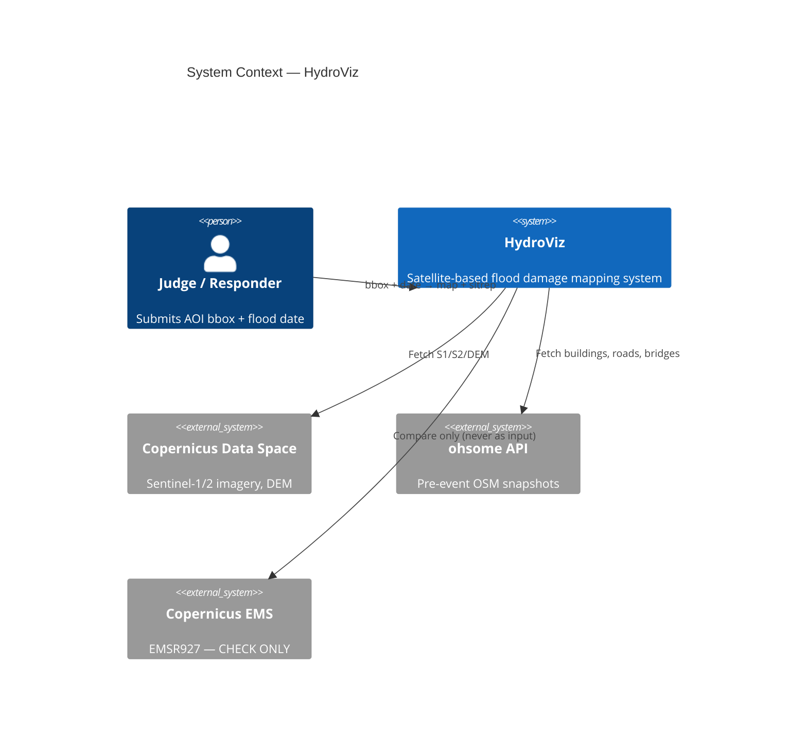
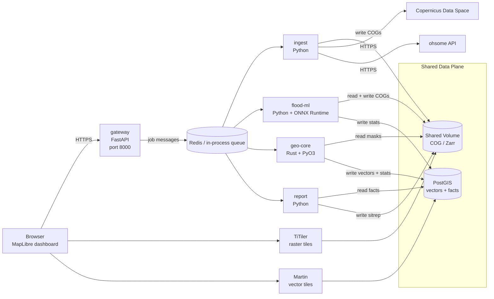
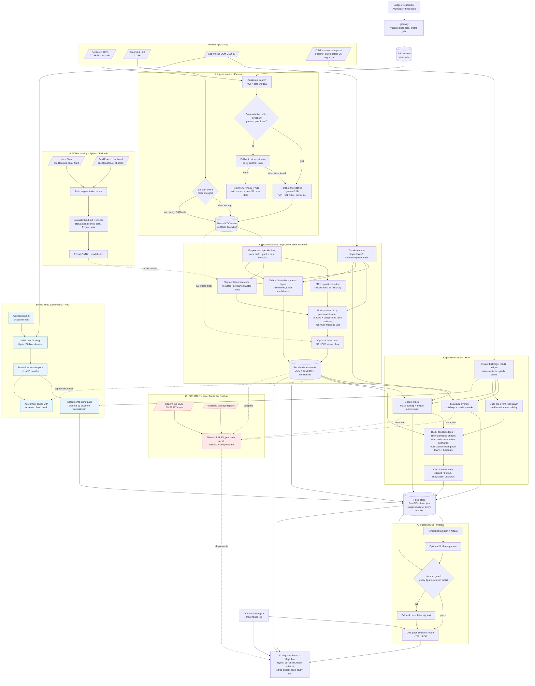

# HydroViz — System Architecture

> Himalayan Flood Response Prototype · Multimodal AI Hackathon 2026, Track B

---

## 1. Design Philosophy

Three non-negotiable principles drive every decision:

1. **Control plane = tiny JSON messages; Data plane = shared files + database.**
   Rasters never travel over HTTP between services. All heavy data lives on a shared volume (COGs) or in PostGIS (vectors + facts). Services exchange only job IDs, statuses, and small metadata.

2. **Single source of truth for every number.**
   `facts.json` (materialised in PostGIS) is the only place from which any user-facing number originates. The report service, dashboard, and Q&A system all read from it. No service may fabricate or cache a number outside this store.

3. **Fail loud, never silently wrong.**
   Every stage either succeeds and writes verified output, or returns a typed error with a human-readable cause. No silent fallbacks that could mislead rescue teams.

---

## 2. System Context



---

## 3. Service Architecture

### 3.1 Service Topology



### 3.2 Service Responsibilities

| Service | Language | Port | Responsibility | Inputs | Outputs |
|---------|----------|------|----------------|--------|---------|
| **gateway** | Python (FastAPI) | 8000 | Job orchestration, validation, progress streaming, serve dashboard static files | User bbox + date | Job status SSE, partial results |
| **ingest** | Python | 8001 | Catalogue search, S1/S2 pair selection, fetch orthorectified imagery, OSM extraction, caching | Job request | COGs on shared volume, provenance records |
| **flood-ml** | Python + ONNX RT | 8002 | Terrain features, preprocessing, baseline + learned inference, post-processing, debris layer, S2 fusion | COGs from volume | Flood + debris masks (COG + vectors), statistics → PostGIS |
| **geo-core** | Rust (PyO3) | 8003 | Exposure overlay, cut-off analysis, flood path tracing | Masks from volume, vectors from PostGIS | Exposure stats, settlement statuses, flow paths → PostGIS |
| **report** | Python | 8004 | Template rendering, number guard, EN/NE sitrep, PDF/HTML | facts from PostGIS | Sitrep files on volume |

### 3.3 Infrastructure Services

| Service | Image | Port | Role |
|---------|-------|------|------|
| **PostgreSQL + PostGIS** | `postgis/postgis:16-3.4` | 5432 | Vector storage, facts store, spatial queries |
| **Redis** | `redis:7-alpine` | 6379 | Job queue (optional; can be in-process for demo) |
| **TiTiler** | `ghcr.io/developmentseed/titiler` | 8080 | Dynamic raster tile serving from COGs |
| **Martin** | `ghcr.io/maplibre/martin` | 3000 | Vector tile serving from PostGIS |

---

## 4. Data Flow — Full Pipeline



---

## 5. External API Contracts

### 5.1 Copernicus Data Space Ecosystem (CDSE)

| API | Purpose | Auth | Key Limits to Verify |
|-----|---------|------|---------------------|
| **STAC / OData Catalogue** | Search S1/S2 acquisitions by AOI, date, platform, orbit | OAuth2 client credentials | Rate limits, pagination |
| **Sentinel Hub Process API** | Fetch orthorectified gamma0 dB (VV+VH) at 10m | OAuth2 bearer token | Free-tier pixel quota, max bbox size, concurrent requests |
| **DEM API** | Copernicus GLO-30 tiles | Same token | Tile size limits |

**Authentication flow:**
```
POST https://identity.dataspace.copernicus.eu/auth/realms/CDSE/protocol/openid-connect/token
  grant_type=client_credentials
  client_id=<from env>
  client_secret=<from env>
→ { access_token, expires_in }
→ refresh before expiry
```

### 5.2 ohsome API

| Endpoint | Purpose | Key Parameters |
|----------|---------|----------------|
| `POST /elements/geometry` | Extract buildings, roads, bridges | `bboxes`, `time` (must be < 2026-08-26), `filter` (OSM tags) |
| `POST /elements/centroid` | Settlement/hospital points | Same |

**Rate limits:** Respect `Retry-After` headers. Cache responses by `(bbox_hash, time, filter)`.

### 5.3 Copernicus EMS (CHECK ONLY)

| Resource | Use |
|----------|-----|
| EMSR927 activation page | Download reference delineation/grading maps |
| Vector products (GeoJSON/GPKG) | IoU / F1 comparison in `validation/` |

**One-way data flow enforced:** validation package imports pipeline output; pipeline NEVER imports validation output.

---

## 6. Database Schema (PostGIS)

```sql
-- Job tracking
CREATE TABLE jobs (
    job_id          UUID PRIMARY KEY,
    bbox            GEOMETRY(Polygon, 4326) NOT NULL,
    event_date      DATE NOT NULL,
    osm_snapshot    DATE NOT NULL,
    status          TEXT NOT NULL DEFAULT 'queued',
    created_at      TIMESTAMPTZ DEFAULT now(),
    updated_at      TIMESTAMPTZ DEFAULT now(),
    options         JSONB DEFAULT '{}'
);

-- Provenance log (one row per input per job)
CREATE TABLE provenance (
    id              SERIAL PRIMARY KEY,
    job_id          UUID REFERENCES jobs(job_id),
    source          TEXT NOT NULL,  -- 's1', 's2', 'dem', 'osm', 'model'
    acquisition_id  TEXT,
    datetime        TIMESTAMPTZ,
    platform        TEXT,
    relative_orbit  INTEGER,
    direction       TEXT,
    snapshot_date   DATE,
    model_version   TEXT,
    model_sha256    TEXT,
    file_path       TEXT,
    created_at      TIMESTAMPTZ DEFAULT now()
);

-- Flood/debris mask statistics
CREATE TABLE flood_stats (
    job_id              UUID REFERENCES jobs(job_id),
    flooded_area_km2    REAL,
    debris_area_km2     REAL,
    mean_confidence     REAL,
    mode                TEXT,  -- 'sar_only' | 'sar_s2'
    mask_cog_path       TEXT,
    debris_cog_path     TEXT,
    created_at          TIMESTAMPTZ DEFAULT now()
);

-- OSM-derived features
CREATE TABLE buildings (
    id              SERIAL PRIMARY KEY,
    job_id          UUID REFERENCES jobs(job_id),
    osm_id          BIGINT,
    geom            GEOMETRY(Polygon, 4326),
    exposure        TEXT,  -- 'exposed_high' | 'exposed_medium' | 'unaffected'
    confidence      REAL
);

CREATE TABLE roads (
    id              SERIAL PRIMARY KEY,
    job_id          UUID REFERENCES jobs(job_id),
    osm_id          BIGINT,
    geom            GEOMETRY(LineString, 4326),
    highway_type    TEXT,
    total_length_m  REAL,
    exposed_length_m REAL
);

CREATE TABLE bridges (
    id              SERIAL PRIMARY KEY,
    job_id          UUID REFERENCES jobs(job_id),
    osm_id          BIGINT,
    geom            GEOMETRY(Geometry, 4326),
    status          TEXT,  -- 'likely_damaged' | 'exposed' | 'unaffected'
    confidence      REAL,
    hand_height     REAL
);

CREATE TABLE settlements (
    id              SERIAL PRIMARY KEY,
    job_id          UUID REFERENCES jobs(job_id),
    osm_id          BIGINT,
    name            TEXT,
    name_ne         TEXT,
    geom            GEOMETRY(Point, 4326),
    place_type      TEXT,
    cutoff_status_strict       TEXT,  -- 'isolated' | 'detour' | 'reachable' | 'unknown'
    cutoff_status_conservative TEXT,
    nearest_town    TEXT,
    nearest_hospital TEXT,
    detour_factor_strict       REAL,
    detour_factor_conservative REAL
);

-- Flood path (bonus)
CREATE TABLE flood_paths (
    id              SERIAL PRIMARY KEY,
    job_id          UUID REFERENCES jobs(job_id),
    origin          GEOMETRY(Point, 4326),
    path            GEOMETRY(LineString, 4326),
    corridor        GEOMETRY(Polygon, 4326),
    hand_threshold  REAL,
    agreement_pct   REAL  -- agreement with observed mask
);

CREATE TABLE flood_path_settlements (
    id              SERIAL PRIMARY KEY,
    flood_path_id   INTEGER REFERENCES flood_paths(id),
    settlement_id   INTEGER REFERENCES settlements(id),
    distance_downstream_m REAL,
    order_index     INTEGER
);

-- Materialised facts view
CREATE TABLE facts (
    job_id          UUID PRIMARY KEY REFERENCES jobs(job_id),
    facts_json      JSONB NOT NULL,
    generated_at    TIMESTAMPTZ DEFAULT now()
);
```

---

## 7. Shared Volume Layout

```
/data/                              ← mounted as shared volume
├── jobs/
│   └── <job_id>/
│       ├── input/
│       │   ├── s1_pre1_vv.tif      ← COG, gamma0 dB
│       │   ├── s1_pre1_vh.tif
│       │   ├── s1_pre2_vv.tif
│       │   ├── s1_pre2_vh.tif
│       │   ├── s1_post_vv.tif
│       │   ├── s1_post_vh.tif
│       │   ├── s2_post.tif         ← L2A (if available)
│       │   ├── s2_scl.tif          ← scene classification layer
│       │   ├── dem.tif             ← Copernicus GLO-30
│       │   └── osm/
│       │       ├── buildings.geojson
│       │       ├── roads.geojson
│       │       └── bridges.geojson
│       ├── features/
│       │   ├── slope.tif
│       │   ├── hand.tif
│       │   ├── shadow_layover.tif
│       │   └── stack.tif           ← normalised input stack
│       ├── output/
│       │   ├── flood_mask.tif      ← COG, per-pixel confidence
│       │   ├── flood_mask.geojson  ← vectorised
│       │   ├── debris_mask.tif
│       │   ├── debris_mask.geojson
│       │   ├── baseline_mask.tif   ← M2 log-ratio baseline
│       │   └── flood_path/
│       │       ├── path.geojson
│       │       └── corridor.geojson
│       ├── reports/
│       │   ├── sitrep_en.html
│       │   ├── sitrep_en.pdf
│       │   ├── sitrep_ne.html
│       │   └── sitrep_ne.pdf
│       └── facts.json              ← snapshot, also in PostGIS
├── cache/                          ← keyed by (aoi_hash, acq_ids)
│   └── <hash>/
│       └── *.tif
└── models/
    ├── flood_seg_v1.onnx
    └── model_card.json
```

---

## 8. Security Model

| Concern | Implementation |
|---------|---------------|
| **Credentials** | Environment variables only (`.env` file, never committed). Docker secrets for production. |
| **Token handling** | Never logged. Refresh automatically before expiry. |
| **Outbound allow-list** | Only: `*.dataspace.copernicus.eu`, `api.ohsome.org`, `mapping.emergency.copernicus.eu` |
| **Input validation** | Strict bbox (valid lat/lon ranges, max area), ISO date format, UUID job IDs |
| **Rate limiting** | Gateway: max 10 jobs/minute per IP |
| **CORS** | Restrict to dashboard origin only |
| **Containers** | Run as non-root user. Pin all dependency versions. |
| **No user uploads** | No file upload endpoints. Only structured JSON input. |

---

## 9. Error Taxonomy

Every error returned by any service uses this structure:

```json
{
    "error_code": "NO_VALID_PAIR",
    "stage": "ingest",
    "message": "No Sentinel-1 acquisitions found with matching orbit track within ±30 days of event",
    "details": {
        "aoi": [85.0, 27.5, 86.0, 28.5],
        "event_date": "2026-08-26",
        "searched_window": ["2026-07-27", "2026-09-25"],
        "next_expected_pass": "2026-09-02"
    },
    "recoverable": false
}
```

| Code | Stage | Meaning |
|------|-------|---------|
| `NO_VALID_PAIR` | ingest | No matching pre+post S1 pair found |
| `ALL_CLOUDY` | ingest | S2 available but below usable cloud threshold; continues SAR-only |
| `AOI_TOO_LARGE` | gateway | Requested area exceeds maximum (~50×50 km) |
| `AOI_INVALID` | gateway | Coordinates out of range or malformed |
| `UPSTREAM_UNAVAILABLE` | ingest | CDSE or ohsome API unreachable after retries |
| `QUOTA_EXCEEDED` | ingest | CDSE free-tier pixel limit hit |
| `MODEL_LOAD_FAILED` | flood-ml | ONNX model file missing or incompatible |
| `NUMBER_GUARD_FAILED` | report | LLM output contained number not in facts; fell back to template |
| `OSM_NO_ROADS` | geo-core | No road data in AOI from OSM snapshot |

---

## 10. Performance Strategy

| Concern | Strategy |
|---------|----------|
| **Network latency** | Dominates. Cache all external API responses. Tile large requests. Parallel fetches. |
| **Memory** | Windowed COG reads. Never load full scene. Stream tiles. |
| **CPU** | Rust geo-core for graph + spatial ops. ONNX Runtime for inference (CPU default, GPU optional). Rayon parallelism in Rust. |
| **Caching** | Content-addressed cache: `sha256(bbox + acq_ids)`. Reuse across jobs for same area. |
| **Progress** | Gateway streams SSE events per stage: `ingesting → processing → analyzing → reporting → complete`. Return partial results (mask first, then exposure, then cut-off, then report). |
| **Benchmarking** | Wall-clock timer per stage per job. Log to structured JSON. Set budgets after first measurements. |

---

## 11. Technology Stack (with versions to verify)

| Component | Choice | Version to Verify | Fallback |
|-----------|--------|-------------------|----------|
| Python | 3.11+ | 3.11 or 3.12 | — |
| FastAPI | Latest | 0.100+ | — |
| Rasterio | Latest | 1.3+ | — |
| PyTorch | 2.x | 2.1+ | — |
| ONNX Runtime | Latest | 1.16+ | — |
| Rust | Stable | 1.75+ | — |
| PyO3 / Maturin | Latest | 0.20+ | gRPC if PyO3 issues |
| petgraph | Latest | 0.6+ | — |
| rstar | Latest | 0.11+ | — |
| geo (Rust) | Latest | 0.28+ | — |
| GDAL (Rust) | Latest | 0.16+ | — |
| MapLibre GL JS | Latest | 4.x | — |
| PostgreSQL | 16 | 16 | 15 |
| PostGIS | 3.4 | 3.4 | 3.3 |
| Redis | 7 | 7.x | In-process queue |
| TiTiler | Latest | 0.18+ | — |
| Martin | Latest | 0.13+ | pg_tileserv |
| WhiteboxTools | Evaluate | 2.3+ | Custom Rust D8 |
