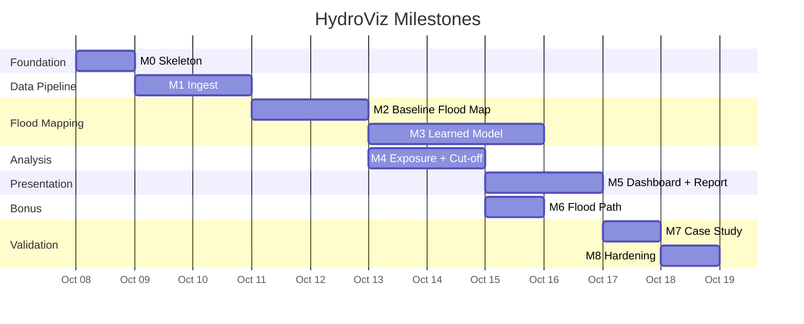

# HydroViz — Implementation Plan

> Step-by-step procedural guide for building every milestone.
> Each milestone has: objective, exact files to create/modify, acceptance criteria, tests to write.

---

## Build Order & Dependencies



> [!IMPORTANT]
> M3 (learned model) can be trained in parallel while building M4/M5. M4 only depends on M2 (baseline mask), not M3.

---

## M0 — Skeleton

### Objective
`docker compose up` starts all services with health checks. Contracts defined. Attribution footer present.

### Files to Create

| File | Content |
|------|---------|
| `docker-compose.yml` | All 9 services (5 app + PostGIS + Redis + TiTiler + Martin) |
| `services/gateway/Dockerfile` | Python 3.11 slim, non-root user |
| `services/gateway/requirements.txt` | fastapi, uvicorn, redis, httpx, pydantic |
| `services/gateway/main.py` | FastAPI app with `/health`, `/jobs` stub, CORS, attribution |
| `services/ingest/Dockerfile` | Python 3.11 slim |
| `services/ingest/requirements.txt` | httpx, rasterio, pystac-client, shapely |
| `services/ingest/main.py` | Health check endpoint, queue listener stub |
| `services/flood_ml/Dockerfile` | Python 3.11, onnxruntime |
| `services/flood_ml/main.py` | Health check, inference stub |
| `services/geo_core/Cargo.toml` | Rust crate with petgraph, rstar, geo, pyo3 |
| `services/geo_core/Dockerfile` | Rust builder + Python 3.11 runtime |
| `services/geo_core/src/lib.rs` | PyO3 module with health check |
| `services/report/Dockerfile` | Python 3.11 slim |
| `services/report/main.py` | Health check, template loading stub |
| `contracts/job_request.schema.json` | JSON Schema from AGENT_BRIEF §5.1 |
| `contracts/job_status.schema.json` | Job status schema |
| `contracts/facts.schema.json` | JSON Schema from AGENT_BRIEF §5.2 |
| `.env.example` | All required env vars (no real secrets) |
| `.gitignore` | Python, Rust, data, secrets |
| `DECISIONS.md` | Initial empty template |
| `README.md` | Project overview, quick start, attributions |

### Steps

1. **Create `.env.example`** with all environment variables:
   ```
   CDSE_CLIENT_ID=
   CDSE_CLIENT_SECRET=
   POSTGRES_HOST=postgres
   POSTGRES_PORT=5432
   POSTGRES_DB=hydroviz
   POSTGRES_USER=hydroviz
   POSTGRES_PASSWORD=
   REDIS_URL=redis://redis:6379
   DATA_DIR=/data
   MODEL_PATH=/data/models/flood_seg_v1.onnx
   MAX_AOI_AREA_KM2=2500
   S2_CLOUD_THRESHOLD=0.7
   ```

2. **Write JSON Schema contracts** from AGENT_BRIEF §5:
   - `job_request.schema.json`: validate bbox array of 4 floats, ISO date strings, options object
   - `facts.schema.json`: full facts structure with required/optional fields
   - `job_status.schema.json`: states (queued → ingesting → processing → analyzing → reporting → complete → failed)

3. **Create each service's Dockerfile + health endpoint:**
   - Each Python service: FastAPI with `GET /health` returning `{"status": "ok", "service": "<name>"}`
   - Rust geo-core: gRPC or HTTP health check via PyO3 wrapper
   - All containers run as UID 1000 (non-root)

4. **Create `docker-compose.yml`:**
   - Define all services with health checks (`curl` or `pg_isready`)
   - Shared volume mounted at `/data`
   - PostGIS with init scripts for schema
   - Dependency ordering: postgres → redis → services → titiler/martin
   - Network: single bridge network `hydroviz-net`

5. **Add attribution footer** as shared constant:
   - Create `services/shared/attribution.py` with all required strings
   - Import in gateway and report services

### Acceptance Criteria
- [ ] `docker compose up` starts without errors
- [ ] All 9 containers pass health checks
- [ ] `curl localhost:8000/health` returns 200
- [ ] Attribution strings present in gateway response headers / metadata endpoint
- [ ] JSON Schema files validate against metaschema

### Tests
- `tests/unit/test_contracts.py` — validate example payloads against schemas
- `tests/smoke/test_health.py` — hit each service's health endpoint

---

## M1 — Ingest

### Objective
For any corridor bbox + event date, pick a valid same-track S1 pair (or return `NO_VALID_PAIR`), fetch and cache COGs, log provenance.

### Files to Create

| File | Content |
|------|---------|
| `services/ingest/auth.py` | CDSE OAuth2 token management (client credentials, auto-refresh) |
| `services/ingest/catalogue.py` | STAC/OData search: S1 IW GRD by AOI, date range, platform, orbit |
| `services/ingest/pair_selector.py` | Same-orbit pair matching: 2 pre + 1 post, fallback logic |
| `services/ingest/fetcher.py` | Process API requests: gamma0 dB, VV+VH, 10m, tiled, retries+backoff |
| `services/ingest/s2_checker.py` | S2 L2A search, cloud fraction check via SCL band |
| `services/ingest/osm_client.py` | ohsome API client: buildings, roads, bridges with time parameter |
| `services/ingest/dem_fetcher.py` | Copernicus GLO-30 DEM fetch for AOI |
| `services/ingest/cache.py` | Content-addressed cache: check/store by (aoi_hash, acq_ids) |
| `services/ingest/provenance.py` | Write provenance records to PostGIS |
| `services/ingest/worker.py` | Queue consumer: orchestrate full ingest pipeline |

### Steps

1. **Implement CDSE authentication:**
   - `POST` to token endpoint with client credentials
   - Store `access_token` + `expires_at`
   - Auto-refresh with 60s buffer
   - Never log tokens

2. **Implement catalogue search:**
   - Query CDSE STAC for `sentinel-1-grd` collection
   - Filter: `bbox`, `datetime` (event_date ± configurable window, start with 30 days)
   - Required properties: `sat:relative_orbit`, `sat:orbit_state` (ascending/descending), `platform`, `s1:instrument_mode` = IW
   - Return structured list of available acquisitions

3. **Implement pair selection logic:**
   - Group acquisitions by (relative_orbit, orbit_direction)
   - For each group: find post-event acquisitions (after event_date), take earliest
   - Find pre-event acquisitions (before event_date) with same orbit, take 2 most recent
   - Validate: all 3 must exist; platforms may differ (S-1C/S-1D) if geometry matches
   - If no valid group: try next orbit group → widen window → return `NO_VALID_PAIR`

4. **Implement data fetching (Low-RAM Optimized):**
   - Use Sentinel Hub Process API (`/api/v1/process`)
   - Request `GAMMA0_TERRAIN` backscatter, `orthorectify: true`, DEM = Copernicus 30m
   - Bands: VV, VH separately
   - Output: GeoTIFF
   - **Resolution constraints:** Use 10m resolution by default, but automatically downsample to 20m if the requested AOI exceeds 500 km² to prevent memory overflow.
   - **Sequential Tiling:** Tile large areas (e.g., 512×512 px chunks). Process these chunks sequentially rather than concurrently to keep peak memory <1GB during ingestion.
   - **Streaming:** Use `rasterio` windowed reading/writing and set `GDAL_CACHEMAX=512` to prevent GDAL from caching massive arrays in memory.
   - Retry with exponential backoff (3 attempts)
   - Save as COGs using rasterio with Deflate compression to save disk I/O.

5. **Implement S2 processing:**
   - Search for closest post-event L2A scene
   - Download SCL (scene classification layer)
   - Calculate usable fraction (exclude cloud, cloud shadow, snow classes)
   - If usable fraction < threshold (default 0.3): set mode = `sar_only`, skip S2
   - Else: fetch RGB + NDWI bands, save as COG

6. **Implement OSM client:**
   - `POST` to ohsome `/elements/geometry` endpoint
   - Filters:
     - Buildings: `building=* and geometry:polygon`
     - Roads: `highway in (motorway,trunk,primary,secondary,tertiary,unclassified,residential,track,path) and geometry:line`
     - Bridges: `bridge=yes and geometry:line`
     - Settlements: `place in (city,town,village,hamlet) and geometry:point`
     - Hospitals: `amenity in (hospital,clinic) and geometry:point`
   - `time` parameter: `osm_snapshot` from job request (must be < 2026-08-26)
   - Save as GeoJSON files

7. **Implement DEM fetch:**
   - Copernicus GLO-30 via CDSE or direct HTTP
   - Mosaic tiles covering AOI
   - Save as single COG

8. **Implement caching and provenance:**
   - Cache key: `sha256(sorted(bbox) + sorted(acq_ids))`
   - On hit: skip fetch, link cached files
   - Provenance: write to PostGIS `provenance` table with all metadata

### Acceptance Criteria
- [ ] For the case study bbox (`[85.0, 27.5, 86.5, 28.5]` approx), catalogue returns S1 acquisitions
- [ ] Pair selector picks valid same-orbit pre+post pair
- [ ] COGs written to `/data/jobs/<job_id>/input/`
- [ ] Provenance table populated with acquisition metadata
- [ ] `NO_VALID_PAIR` returned gracefully for impossible dates/areas
- [ ] OSM data fetched with correct pre-event snapshot date
- [ ] Cache hit on re-run of same area

### Tests
- `tests/unit/test_pair_selector.py` — synthetic acquisition lists, verify correct pairing
- `tests/unit/test_pair_selector_no_pair.py` — verify `NO_VALID_PAIR` on impossible data
- `tests/unit/test_cache.py` — verify content-addressed cache logic
- `tests/integration/test_ingest_live.py` — (gated) full ingest on small bbox

---

## M2 — Baseline Flood Map

### Objective
Log-ratio change detection + terrain masks produce a hazard mask and vector layer visible on the map.

### Files to Create

| File | Content |
|------|---------|
| `services/flood_ml/terrain.py` | Slope, HAND, shadow/layover from DEM |
| `services/flood_ml/preprocess.py` | Speckle filter (Lee/refined Lee), co-registration check, stack building, normalisation |
| `services/flood_ml/baseline.py` | Log-ratio VV+VH change detection, adaptive thresholding |
| `services/flood_ml/postprocess.py` | Remove permanent water, suppress shadow/steep FP, minimum mapping unit, vectorise |
| `services/flood_ml/workers.py` | Queue consumer for flood-ml stage |

### Steps

1. **Terrain features from DEM:**
   - **Slope:** compute from DEM using `numpy.gradient`, output in degrees
   - **HAND (Height Above Nearest Drainage):**
     - Fill DEM pits
     - Compute D8 flow direction
     - Compute flow accumulation
     - Identify drainage pixels (accumulation > threshold)
     - For each pixel, trace to nearest drainage, record height difference
   - **Shadow/layover mask:**
     - From DEM + SAR incidence angle (from S1 metadata)
     - Shadow: DEM slope > (90° - incidence angle) on the far side
     - Layover: DEM slope > incidence angle on the near side
   - Save all as COGs in `features/`

2. **Preprocessing (Low-RAM Optimized):**
   - **Block-wise Processing:** Perform all preprocessing and filtering using `rasterio.windows` block-by-block with a padding margin to prevent edge artifacts.
   - Apply speckle filter (refined Lee, 7×7 window) to each S1 band per block.
   - Co-registration check: cross-correlate pre and post, warn if shift > 1 pixel.
   - Build stack virtually or write block-by-block directly to disk: [pre2, pre1, post] (6 bands).
   - Add terrain channels: [slope, HAND, shadow_layover] (9 bands total).
   - Normalise to training data statistics (for M3; for M2 use raw dB).

3. **Log-ratio baseline (M2):**
   - Compute log-ratio: `post_VV_dB - mean(pre1_VV_dB, pre2_VV_dB)` (and same for VH)
   - Flooded areas: strong negative VV change (water is smooth → low backscatter)
   - Threshold: Otsu or data-driven (KI method: fit two Gaussians to change histogram)
   - Combine VV and VH evidence
   - Mask out: shadow/layover pixels, slopes > 15°, HAND > configurable max (e.g., 30m)
   - This baseline is ALWAYS computed, even when M3 is available, for comparison

4. **Post-processing:**
   - Permanent water removal: if a pixel was already water-like in BOTH pre-images, exclude it
   - Suppress steep-slope false positives: slope > 20° → require stronger signal
   - Minimum mapping unit: remove connected components < 500 m² (5 pixels at 10m)
   - Vectorise: raster mask → polygons with `rasterio.features.shapes`
   - Assign confidence: distance from threshold → [0, 1] confidence
   - Write flood mask COG + GeoJSON
   - Compute statistics: flooded_area_km2 → facts.json

### Acceptance Criteria
- [ ] `slope.tif`, `hand.tif`, `shadow_layover.tif` generated correctly
- [ ] Log-ratio change map visible, reasonable flood extent
- [ ] Shadow/layover areas masked out
- [ ] Permanent water excluded
- [ ] `flood_mask.tif` + `flood_mask.geojson` written
- [ ] Statistics in `facts.json`: `flooded_area_km2`, `mean_confidence`
- [ ] Visible on dashboard map (even basic tile serving)

### Tests
- `tests/unit/test_terrain.py` — slope/HAND on synthetic DEM
- `tests/unit/test_baseline.py` — log-ratio on synthetic pre/post
- `tests/unit/test_postprocess.py` — permanent water removal, min mapping unit

---

## M3 — Learned Model (8GB RAM Optimized)

### Objective
Deploy a pre-trained segmentation model (e.g., lightweight U-Net or Prithvi-EO converted to ONNX) to beat the baseline on held-out data, specifically optimized to run within an 8 GB RAM limitation.

### Files to Create

| File | Content |
|------|---------|
| `services/flood_ml/models/download_weights.py` | Fetches pre-trained ONNX weights (e.g., Sen1Floods11 U-Net) |
| `services/flood_ml/processors/quantize.py` | Optional script to apply INT8 quantization to ONNX models |
| `services/flood_ml/inference.py` | ONNX Runtime sliding-window inference with memory chunking |
| `docs/model_card.md` | Model provenance, licences, metrics, known failure modes |
| `scripts/evaluate_himalayan.py` | Himalayan evaluation on historical events |

### Steps

1. **Pre-trained Model Procurement:**
   - Instead of training from scratch, download open-source pre-trained weights (e.g., IBM-NASA Prithvi-EO fine-tuned on Sen1Floods11, or community PyTorch U-Net models).
   - If in PyTorch format, convert to ONNX opset 17.
   - Host the ONNX file or use a script (`download_weights.py`) to pull it during container initialization.

2. **Memory Optimizations (8GB RAM Target):**
   - **Quantization:** Implement INT8 quantization via `onnxruntime.quantization` to reduce the model size by ~75% while maintaining accuracy.
   - **Tile Chunking:** Configure `inference.py` to process large inputs in chunks (e.g., 512×512 pixels). Do NOT load entire 2500×2500 scenes into memory at once.
   - **Garbage Collection:** Enforce aggressive `gc.collect()` in Python workers after processing each chunk.
   - **Docker Limits:** Update `docker-compose.yml` to apply a hard memory limit of `2g` to the `flood_ml` container to prevent host OOM.

3. **Inference Service Integration:**
   - Load ONNX model at startup into `onnxruntime.InferenceSession`.
   - Implement overlapping sliding window inference.
   - Output: per-pixel class probabilities → argmax → mask.
   - Apply same post-processing as M2 (remove permanent water, MMU, vectorization).

4. **Build Himalayan Evaluation Set:**
   - Earlier events: Chamoli 2021, Melamchi 2021, South Lhonak 2023.
   - Fetch cloud-free Sentinel-2 for each.
   - Compute NDWI/MNDWI → threshold → weak flood labels.
   - Run the optimized ONNX model on these inputs to record Himalayan evaluation numbers.

### Acceptance Criteria
- [ ] Pre-trained ONNX model successfully loaded without OOM on 8GB host.
- [ ] Sliding window chunking limits peak memory usage to <2GB per worker.
- [ ] Himalayan evaluation numbers recorded.
- [ ] Model card completed.
- [ ] ONNX inference in flood-ml service matches expected output visually on dashboard.

### Tests
- `tests/unit/test_inference.py` — ONNX inference on small synthetic tile verifying memory usage.

---

## M4 — Exposure + Cut-off

### Objective
Building/road/bridge exposure counts and settlement cut-off statuses in `facts.json`. Strict vs conservative scenarios. Unit tests on synthetic graph.

### Files to Create

| File | Content |
|------|---------|
| `services/geo_core/src/exposure.rs` | R-tree spatial index, building/road/bridge overlay |
| `services/geo_core/src/graph.rs` | Road graph construction from OSM |
| `services/geo_core/src/cutoff.rs` | Edge blocking, multi-source Dijkstra, settlement classification |
| `services/geo_core/src/osm.rs` | GeoJSON parsing for OSM features |
| `services/geo_core/src/types.rs` | Shared types: Settlement, Bridge, ExposureResult |
| `services/geo_core/src/lib.rs` | PyO3 module exposing all functions to Python |
| `services/geo_core/python/geo_core_py/__init__.py` | Python wrapper |
| `services/geo_core/worker.py` | Queue consumer, orchestrate geo analysis |

### Steps

1. **Exposure analysis (Rust):**
   - Load flood/debris mask polygons (from GeoJSON)
   - Build R-tree spatial index over mask polygons
   - **Buildings:**
     - For each building polygon: check intersection with mask
     - `exposed_high`: footprint intersects high-confidence (≥0.7) mask
     - `exposed_medium`: within 10m buffer of mask OR intersects low-confidence only
     - `unaffected`: no intersection or proximity
   - **Roads:**
     - For each road segment: compute length intersecting mask
     - Record total_length_m and exposed_length_m
   - **Bridges:**
     - Check if bridge geometry overlaps high-confidence mask
     - If yes AND bridge HAND height < configurable threshold → `likely_damaged`
     - If overlaps any mask → `exposed`
     - Else → `unaffected`
   - Use `rayon` for parallel processing

2. **Road graph construction (Rust):**
   - Parse OSM road GeoJSON
   - Build graph: nodes = intersections + endpoints, edges = road segments
   - Edge weights: length in meters
   - Two modes:
     - `road_only`: highway types motorway through residential
     - `road_track_path`: adds tracks and paths (walking access)
   - Identify target nodes: towns (`place=town|city`), hospitals (`amenity=hospital|clinic`)
   - Identify source nodes: settlements (`place=village|hamlet|...`)

3. **Baseline reachability:**
   - Run multi-source Dijkstra from all targets
   - Record baseline distance from each settlement to nearest town and hospital
   - Settlements unreachable in baseline = `unknown` (NOT `isolated`)

4. **Cut-off analysis (two scenarios):**
   - **Strict:** block edges intersecting high-confidence flood mask
   - **Conservative:** block edges intersecting any confidence flood mask + medium-confidence debris
   - Also block edges crossing `likely_damaged` bridges
   - Re-run multi-source Dijkstra
   - Classify each settlement:
     - `isolated`: was reachable, now disconnected
     - `detour`: still reachable but distance increased by > threshold (e.g., 2×)
     - `reachable`: distance change < threshold
     - `unknown`: was never reachable in baseline (no OSM road data)
   - Record `detour_factor` = new_distance / baseline_distance

5. **Write results to PostGIS and facts.json:**
   - Settlement statuses with both scenario results
   - Aggregate counts: total buildings exposed, roads km affected, bridges damaged
   - All numbers → facts.json

### Acceptance Criteria
- [ ] Building exposure counts match manual spot-check
- [ ] Road exposure in km calculated
- [ ] Bridge statuses assigned with confidence
- [ ] Road graph built with correct topology
- [ ] Baseline reachability computed
- [ ] `strict` and `conservative` scenarios produce different (meaningful) results
- [ ] Never-connected settlements = `unknown`, not `isolated`
- [ ] `road_only` vs `road_track_path` modes work
- [ ] All results in facts.json
- [ ] Benchmark: full corridor processed in < 30 seconds

### Tests
- `tests/unit/test_exposure.py` — synthetic buildings + mask, verify classification
- `tests/unit/test_cutoff.py` — synthetic graph with known answer (4-node graph, block one edge)
- `tests/unit/test_graph_unknown.py` — verify disconnected-from-start = `unknown`
- `tests/fixtures/synthetic_graph.json` — reusable test fixture

---

## M5 — Dashboard + Report

### Objective
End-to-end from bbox + date to interactive map and one-page EN/NE situation report. Number guard tests pass.

### Files to Create

| File | Content |
|------|---------|
| `dashboard/index.html` | MapLibre app shell |
| `dashboard/index.css` | Responsive dark theme, layer controls |
| `dashboard/index.js` | Map init, layer management, controls, SSE progress |
| `dashboard/layers/flood.js` | Flood mask layer (raster tiles from TiTiler) |
| `dashboard/layers/exposure.js` | Building/road/bridge vector layers |
| `dashboard/layers/cutoff.js` | Settlement status markers (color-coded) |
| `dashboard/layers/flood_path.js` | Bonus: flow path layer |
| `dashboard/components/sidebar.js` | Cut-off list, search, scenario toggle |
| `dashboard/components/swipe.js` | Pre/post image comparison swipe |
| `dashboard/components/job_form.js` | AOI drawing + date picker |
| `dashboard/components/report_panel.js` | Report preview + download |
| `services/report/templates/en/sitrep.html` | English situation report template (Jinja2) |
| `services/report/templates/ne/sitrep.html` | Nepali situation report template |
| `services/report/templates/strings_ne.json` | Reviewed Nepali string table |
| `services/report/number_guard.py` | Extract all numerals, validate against facts |
| `services/report/generator.py` | Render template → HTML → PDF (weasyprint) |
| `services/report/llm_paraphrase.py` | Optional LLM paraphrase with guard |

### Steps

1. **Dashboard:**
   - MapLibre GL JS with dark basemap
   - Layer controls: flood mask (opacity slider), debris (separate toggle), buildings (color by exposure), roads, bridges, settlements (color by cut-off status)
   - Scenario toggle: strict / conservative
   - Pre/post swipe: compare S1 pre vs post
   - Sidebar: searchable cut-off settlements list with details
   - Job form: draw bbox on map, pick date, submit
   - Progress bar: SSE from gateway showing stage transitions
   - Case-study tab: validation metrics display
   - Flood path tool: click to place upstream point
   - Attribution footer (always visible)
   - "Educational prototype" banner

2. **Report templates:**
   - English sitrep structure:
     - Header: AOI description, event date, data sources + acquisition times
     - Headline numbers: flooded area, buildings exposed, roads affected, settlements cut off
     - Cut-off settlements table (sorted by severity)
     - Infrastructure damage summary
     - Confidence and limitations box
     - Attribution footer
   - Nepali version: same structure, Nepali strings from `strings_ne.json`
   - All numbers inserted via `{{ facts.flood.flooded_area_km2 }}` template variables

3. **Number guard:**
   - After rendering, extract EVERY numeral from the output text
   - Normalise Devanagari digits (०-९ → 0-9)
   - Build allowed set from facts.json (all numeric values, including computed ones like percentages)
   - If any extracted number NOT in allowed set → reject, fall back to template-only text
   - Log the rejected text and the offending number

4. **PDF generation:**
   - Use `weasyprint` to render HTML → PDF
   - Ensure Nepali Unicode font is bundled (Noto Sans Devanagari)
   - Single page layout

5. **Gateway integration:**
   - `POST /jobs` → create job, start pipeline
   - `GET /jobs/{id}/status` → SSE stream of progress events
   - `GET /jobs/{id}/facts` → return facts.json
   - `GET /jobs/{id}/report/{lang}` → serve sitrep HTML or PDF
   - Serve dashboard static files at `/`

### Acceptance Criteria
- [ ] Dashboard loads with all layer controls
- [ ] Submit bbox+date → see progress → see results on map
- [ ] Layer toggle works for all layers
- [ ] Scenario toggle switches strict/conservative cut-off display
- [ ] Cut-off list is searchable and highlights on map
- [ ] Pre/post swipe works
- [ ] Attribution footer always visible
- [ ] "Educational prototype" banner present
- [ ] EN sitrep generated with correct numbers from facts
- [ ] NE sitrep generated with Devanagari text
- [ ] Number guard catches injected fake number
- [ ] PDF renders correctly with Nepali font

### Tests
- `tests/unit/test_number_guard.py` — pass/fail cases, Devanagari digits
- `tests/unit/test_number_guard_devanagari.py` — specifically test ०-९ normalisation
- `tests/unit/test_template_render.py` — template produces valid HTML
- `tests/integration/test_end_to_end.py` — full pipeline from bbox to report

---

## M6 — Bonus: Flood Path

### Objective
Click an upstream point on the map → traced downstream path + ordered settlement list.

### Files to Create

| File | Content |
|------|---------|
| `services/geo_core/src/flowpath.rs` | DEM conditioning, D8 flow, downstream tracing, HAND corridor |
| `services/geo_core/src/dem.rs` | DEM utilities: pit filling, flow accumulation |

### Steps

1. **DEM conditioning:**
   - Fill pits using priority-flood algorithm (Barnes et al. 2014)
   - Compute D8 flow direction (steepest descent to 8 neighbours)
   - Compute flow accumulation

2. **Snap upstream point:**
   - Snap user's click to nearest high-accumulation cell within a configurable radius (default: 500m)
   - If no high-accumulation cell nearby, return error

3. **Trace downstream:**
   - Follow D8 flow direction from snapped point
   - Stop at: AOI edge, or max length (default: 100 km), or flow accumulation decreases (divergence)
   - Output: LineString of path

4. **Build HAND corridor:**
   - For each pixel along the path, include all cells within a configurable HAND threshold (default: 15m)
   - Output: Polygon of susceptibility corridor

5. **Settlements along path:**
   - Intersect corridor with settlement points
   - Order by distance downstream from origin
   - Output: ordered list with distance

6. **Agreement check:**
   - Compare corridor with observed flood mask
   - Report: % of corridor that overlaps flood, % of flood within corridor
   - This is a sanity check, not a validation metric

7. **Dashboard integration:**
   - Click tool: place upstream point on map
   - Show traced path as line layer
   - Show corridor as semi-transparent polygon
   - Show ordered settlement list in sidebar

### Acceptance Criteria
- [ ] Click on upstream point → path traced in < 5 seconds
- [ ] Path follows expected river course
- [ ] Corridor is reasonable (not too wide, not too narrow)
- [ ] Settlements listed in downstream order
- [ ] Agreement percentage computed and displayed
- [ ] Label: "susceptibility corridor from terrain", NOT hydraulic simulation

### Tests
- `tests/unit/test_flowpath.py` — synthetic DEM with known flow path
- `tests/unit/test_pit_fill.py` — verify pit filling on small grid

---

## M7 — Case Study

### Objective
EMSR927 comparison tables and figures. Limitations section written.

### Files to Create

| File | Content |
|------|---------|
| `validation/download_emsr927.py` | Download EMSR927 reference products |
| `validation/compare_flood.py` | Flood extent IoU, precision, recall |
| `validation/compare_exposure.py` | Building/bridge count comparison |
| `validation/metrics.py` | Shared metrics functions |
| `validation/report.py` | Generate comparison figures and tables |
| `docs/report.md` | 6-page report (start from M0, refine here) |
| `docs/limitations.md` | Comprehensive limitations section |

### Steps

1. **Download EMSR927 reference data:**
   - From `mapping.emergency.copernicus.eu`
   - Products: delineation maps (flood extent), grading maps (damage assessment)
   - Download as GeoPackage or GeoJSON
   - Store in `validation/reference_data/`

2. **Flood extent comparison:**
   - Rasterise both our mask and EMS delineation to same grid
   - Compute: IoU, precision, recall, F1
   - Per-class breakdown if EMS has multiple classes
   - Generate figure: overlay showing agreement/disagreement

3. **Exposure comparison:**
   - Our exposed buildings count vs EMS destroyed/damaged counts
   - Note: these measure DIFFERENT things — we measure "exposed" (proxy from 10m), they measure observed damage
   - Document this difference clearly
   - Same for bridges and roads

4. **Generate comparison report:**
   - Tables: metric values
   - Figures: spatial agreement maps
   - Discussion: where we agree, where we disagree, WHY (gorge geometry, shadow, timing, resolution)

5. **Limitations document:**
   - Copy from AGENT_BRIEF §11 as starting point
   - Add specific findings from the case study
   - Be honest about every failure mode

### Acceptance Criteria
- [ ] EMSR927 data downloaded and stored in `validation/`
- [ ] IoU/F1/precision/recall computed for flood extent
- [ ] Building/bridge comparison table with caveats
- [ ] Figures showing spatial agreement/disagreement
- [ ] Limitations document is comprehensive and honest
- [ ] All data flows are one-way (pipeline → validation, never back)
- [ ] Attribution: "European Union, Copernicus Emergency Management Service data"

---

## M8 — Hardening

### Objective
System handles edge cases gracefully. Dry-run on 5+ random areas/dates. Demo script and video ready.

### Steps

1. **Dry runs (minimum 5):**
   - Case study area (Bhote Koshi-Trishuli corridor) — must work
   - Random mountain area with no flood — should show empty/minimal results
   - Coastal area — different terrain, should still work
   - Area with no S1 coverage — should return `NO_VALID_PAIR`
   - Area with all-cloudy S2 — should run SAR-only mode
   - Very small area — should work fast
   - Area at max size — should work within resource limits

2. **Edge case handling:**
   - Verify all error codes fire correctly
   - Verify progress streaming works for long jobs
   - Verify cache hit on re-run
   - Verify partial results are returned even if later stages fail

3. **Demo script:**
   - Write step-by-step demo narrative in `docs/demo_script.md`
   - 3-minute video plan
   - Rehearse at least twice

4. **Final checklist:**
   - [ ] `README.md` updated with final run instructions
   - [ ] All attributions present
   - [ ] All citations correct
   - [ ] `DECISIONS.md` up to date
   - [ ] Provenance logs verified
   - [ ] No victim images anywhere
   - [ ] "Educational prototype" disclaimer visible

### Acceptance Criteria
- [ ] 5+ dry runs complete (or fail gracefully with typed errors)
- [ ] Demo script written and rehearsed
- [ ] 3-minute video recorded
- [ ] All deliverables checklist items complete
