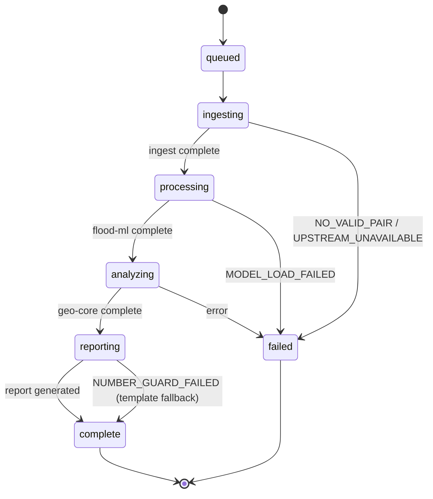

# HydroViz — API Contracts & Data Schemas

> Every data structure exchanged between services or shown to users.
> JSON Schema files in `contracts/` are the machine-readable versions.

---

## 1. Job Request

Submitted by the user (or judge) to start a flood analysis.

```json
{
    "$schema": "http://json-schema.org/draft-07/schema#",
    "title": "HydroViz Job Request",
    "type": "object",
    "required": ["bbox", "event_date"],
    "properties": {
        "job_id": {
            "type": "string",
            "format": "uuid",
            "description": "Auto-generated if not provided"
        },
        "bbox": {
            "type": "array",
            "items": { "type": "number" },
            "minItems": 4,
            "maxItems": 4,
            "description": "[minLon, minLat, maxLon, maxLat] in WGS84"
        },
        "event_date": {
            "type": "string",
            "format": "date",
            "description": "ISO 8601 date of the flood event"
        },
        "osm_snapshot": {
            "type": "string",
            "format": "date",
            "default": "2026-07-27",
            "description": "Must be before event_date"
        },
        "options": {
            "type": "object",
            "properties": {
                "cutoff_modes": {
                    "type": "array",
                    "items": { "enum": ["road_only", "road_track_path"] },
                    "default": ["road_only"]
                },
                "scenarios": {
                    "type": "array",
                    "items": { "enum": ["strict", "conservative"] },
                    "default": ["strict", "conservative"]
                },
                "use_s2": { "type": "boolean", "default": true },
                "flow_path_origin": {
                    "oneOf": [
                        { "type": "null" },
                        {
                            "type": "array",
                            "items": { "type": "number" },
                            "minItems": 2,
                            "maxItems": 2,
                            "description": "[lon, lat] upstream point"
                        }
                    ],
                    "default": null
                }
            }
        }
    }
}
```

### Validation Rules
- `bbox[0] < bbox[2]` (minLon < maxLon)
- `bbox[1] < bbox[3]` (minLat < maxLat)
- All coordinates in valid WGS84 range (-180/180, -90/90)
- Area must be ≤ `MAX_AOI_AREA_KM2` (default: 2500 km²)
- Area must be ≥ 1 km²
- `osm_snapshot` < `event_date`
- `event_date` must be in the past

---

## 2. Job Status

Returned by the gateway to track job progress.

```json
{
    "job_id": "uuid",
    "status": "ingesting",
    "stage": "catalogue_search",
    "progress": 0.15,
    "stages": {
        "ingest": {
            "status": "running",
            "started_at": "2026-08-26T10:00:00Z",
            "substage": "catalogue_search",
            "message": "Searching CDSE catalogue for Sentinel-1 acquisitions..."
        },
        "flood_ml": { "status": "pending" },
        "geo_core": { "status": "pending" },
        "report": { "status": "pending" }
    },
    "partial_results": {
        "s1_pair_found": true,
        "s2_available": false,
        "mode": "sar_only"
    },
    "error": null,
    "created_at": "2026-08-26T09:59:00Z",
    "updated_at": "2026-08-26T10:00:05Z"
}
```

### Status State Machine



---

## 3. Facts Schema

The single source of truth for every number. Generated by the pipeline, consumed by report and dashboard.

```json
{
    "job_id": "uuid",
    "aoi": {
        "bbox": [85.0, 27.5, 86.5, 28.5],
        "area_km2": 1500.0
    },
    "event_date": "2026-08-26",
    "generated_at": "2026-08-26T12:00:00Z",

    "inputs": {
        "s1_pre": [
            {
                "id": "S1C_IW_GRDH_1SDV_20260814...",
                "datetime": "2026-08-14T00:30:00Z",
                "platform": "Sentinel-1C",
                "relative_orbit": 77,
                "direction": "ascending"
            },
            {
                "id": "S1D_IW_GRDH_1SDV_20260802...",
                "datetime": "2026-08-02T00:30:00Z",
                "platform": "Sentinel-1D",
                "relative_orbit": 77,
                "direction": "ascending"
            }
        ],
        "s1_post": {
            "id": "S1C_IW_GRDH_1SDV_20260826...",
            "datetime": "2026-08-26T00:30:00Z",
            "platform": "Sentinel-1C",
            "relative_orbit": 77,
            "direction": "ascending"
        },
        "s2_post": null,
        "osm_snapshot": "2026-07-27",
        "dem": "COPERNICUS_30",
        "model": {
            "name": "hydroviz-flood-seg",
            "version": "v1.0.0",
            "sha256": "abc123..."
        }
    },

    "flood": {
        "flooded_area_km2": 0.0,
        "debris_area_km2": 0.0,
        "mean_confidence": 0.0,
        "mode": "sar_only"
    },

    "exposure": {
        "buildings": {
            "total": 0,
            "exposed_high": 0,
            "exposed_medium": 0
        },
        "roads_km": {
            "total": 0.0,
            "exposed": 0.0
        },
        "bridges": []
    },

    "cutoff": {
        "mode": "road_only",
        "scenario": "strict",
        "settlements": []
    },

    "flood_path": null,

    "limitations": [
        "SAR shadow affects ~X% of valley floor in this AOI",
        "OSM road coverage is incomplete for this area",
        "S2 optical data unavailable due to cloud cover"
    ],

    "provenance": [
        {
            "source": "sentinel-1",
            "acquisition_id": "...",
            "datetime": "...",
            "file_path": "/data/jobs/.../input/s1_post_vv.tif"
        }
    ]
}
```

### Wording Constraints
| ✅ Say | ❌ Never Say |
|--------|-------------|
| exposed | destroyed |
| likely damaged | collapsed |
| exposed (high confidence) | confirmed damaged |
| unknown | safe |
| susceptibility corridor | flood prediction |

---

## 4. Provenance Record

One record per input per job. Proves no forbidden inputs were used.

```json
{
    "job_id": "uuid",
    "entries": [
        {
            "source": "sentinel-1",
            "role": "pre_event_1",
            "acquisition_id": "S1C_IW_GRDH_1SDV_20260814T003000_...",
            "datetime": "2026-08-14T00:30:00Z",
            "platform": "Sentinel-1C",
            "relative_orbit": 77,
            "orbit_direction": "ascending",
            "processing": "gamma0_terrain_dB",
            "downloaded_from": "https://sh.dataspace.copernicus.eu/api/v1/process",
            "file_sha256": "...",
            "file_path": "/data/jobs/.../input/s1_pre1_vv.tif"
        },
        {
            "source": "osm",
            "role": "infrastructure",
            "snapshot_date": "2026-07-27",
            "downloaded_from": "https://api.ohsome.org/v1/elements/geometry",
            "filter": "building=* and geometry:polygon",
            "bbox": [85.0, 27.5, 86.5, 28.5],
            "file_sha256": "...",
            "file_path": "/data/jobs/.../input/osm/buildings.geojson"
        },
        {
            "source": "model",
            "role": "flood_segmentation",
            "name": "hydroviz-flood-seg",
            "version": "v1.0.0",
            "trained_on": ["kuro_siwo_benchmark_v1"],
            "file_sha256": "...",
            "file_path": "/data/models/flood_seg_v1.onnx"
        }
    ]
}
```

---

## 5. Error Response

```json
{
    "error_code": "NO_VALID_PAIR",
    "stage": "ingest",
    "message": "No Sentinel-1 acquisitions with matching orbit track within ±30 days",
    "details": {
        "aoi": [85.0, 27.5, 86.5, 28.5],
        "event_date": "2026-08-26",
        "searched_window": ["2026-07-27", "2026-09-25"],
        "tracks_checked": [77, 12, 165],
        "next_expected_pass": "2026-09-02"
    },
    "recoverable": false,
    "timestamp": "2026-08-26T10:00:05Z"
}
```

### Error Code Registry

| Code | Stage | HTTP | Recoverable | Description |
|------|-------|------|-------------|-------------|
| `AOI_INVALID` | gateway | 400 | No | Bbox coordinates invalid |
| `AOI_TOO_LARGE` | gateway | 400 | No | Area exceeds maximum |
| `AOI_TOO_SMALL` | gateway | 400 | No | Area below minimum |
| `DATE_INVALID` | gateway | 400 | No | Date format invalid or in future |
| `SNAPSHOT_AFTER_EVENT` | gateway | 400 | No | OSM snapshot date ≥ event date |
| `NO_VALID_PAIR` | ingest | 200* | No | No same-orbit S1 pair found |
| `ALL_CLOUDY` | ingest | 200* | No | S2 unusable; proceeds SAR-only |
| `UPSTREAM_UNAVAILABLE` | ingest | 503 | Yes | CDSE/ohsome API down |
| `QUOTA_EXCEEDED` | ingest | 429 | Yes | API rate/quota limit hit |
| `MODEL_LOAD_FAILED` | flood-ml | 500 | No | ONNX model file issue |
| `NUMBER_GUARD_FAILED` | report | 200* | Yes | LLM text rejected; template fallback |
| `OSM_NO_ROADS` | geo-core | 200* | No | No road network in AOI |

*\*200 because the job continues with degraded output rather than failing entirely.*

---

## 6. SSE Progress Events

Gateway streams these to the dashboard:

```
event: stage_update
data: {"stage": "ingest", "status": "running", "substage": "catalogue_search", "message": "Searching for S1 acquisitions..."}

event: stage_update
data: {"stage": "ingest", "status": "running", "substage": "pair_selection", "message": "Found 3 acquisitions on orbit 77, selecting pair..."}

event: stage_update
data: {"stage": "ingest", "status": "running", "substage": "fetching", "message": "Downloading post-event VV (tile 1/4)..."}

event: partial_result
data: {"type": "pair_info", "s1_post": {"id": "...", "datetime": "..."}, "s1_pre": [...]}

event: stage_update
data: {"stage": "ingest", "status": "complete"}

event: stage_update
data: {"stage": "flood_ml", "status": "running", "substage": "terrain_features"}

event: partial_result
data: {"type": "flood_mask", "cog_path": "/data/jobs/.../output/flood_mask.tif"}

event: stage_update
data: {"stage": "flood_ml", "status": "complete", "stats": {"flooded_area_km2": 12.5}}

event: stage_update
data: {"stage": "geo_core", "status": "running"}

event: partial_result
data: {"type": "exposure", "buildings_exposed": 234}

event: partial_result
data: {"type": "cutoff", "isolated_count": 12, "detour_count": 8}

event: stage_update
data: {"stage": "report", "status": "complete"}

event: job_complete
data: {"job_id": "...", "facts_url": "/jobs/.../facts", "report_url": "/jobs/.../report/en"}
```
