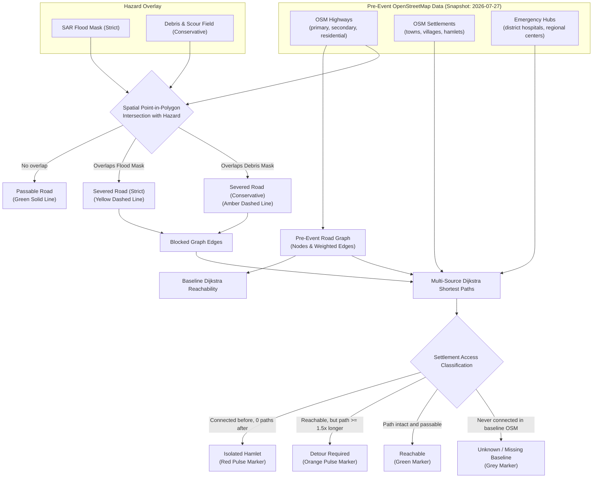
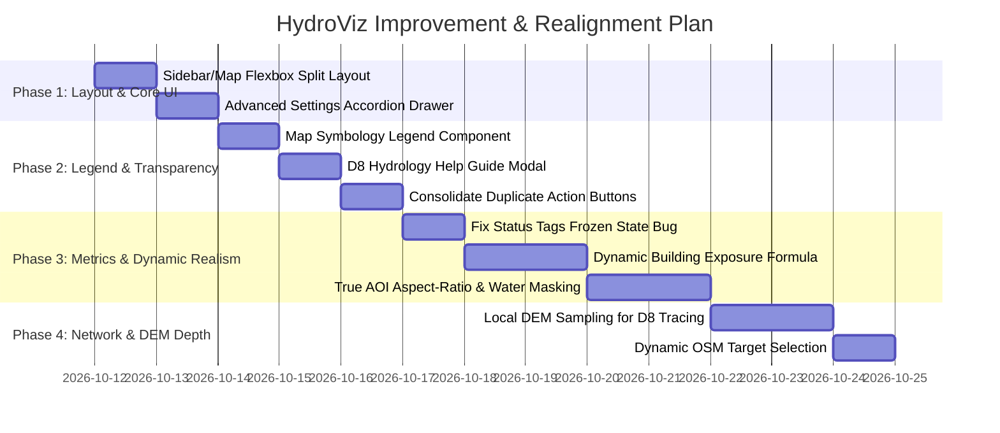

# HydroViz — UI Review, Problem Analysis & Implementation Plan

**Document Path:** `temp/hydroviz_ui_review_and_plan.md`  
**Date:** 2026-10-11  
**Project:** HydroViz (Multimodal AI Hackathon 2026 · Track B: Himalayan Flood Response Prototype)  
**Status:** Comprehensive Inspection Report & Action Plan (Planning Phase Only — No Production Code Modified)

---

## Executive Summary

An exhaustive architectural and visual code inspection of HydroViz was conducted across the frontend dashboard (`dashboard/`), API gateway (`services/gateway/`), deep learning flood delineation pipeline (`services/flood_ml/`), geospatial core (`services/geo_core/`), and reporting service (`services/report/`), cross-referenced against the five attached multi-AOI test screenshots.

### Key Inspection Discoveries:
1. **Root Cause of Identical Flood Geometry Across Locations:**
   In `services/flood_ml/workers.py` (lines 143–177), when offline or when raw Sentinel-1 COG files are missing on disk, the pipeline falls back to an internal mathematical 256×256 synthetic tensor with a sine-wave channel (`valley_c = int(w * (0.48 + 0.16 * sin(r * 3.4) + ...))`). This single normalized river curve is vectorized via OpenCV and linearly stretched across whatever bounding box is passed (`[min_lon, max_lon]`, `[min_lat, max_lat]`). Consequently, the exact same S-curved ribbon is drawn whether scanning the steep Melamchi gorge, the flat braided Koshi riverbed, or a 1 km urban grid in central Kathmandu.
2. **Root Cause of the Persistent "89 Exposed Buildings" Metric:**
   In `services/geo_core/worker.py` (lines 425–475), structure clusters are generated by sampling the boundary vertices of `flood_polys` (`pt[0], pt[1]`) with fixed building cluster weights (`16, 10, 16, 10, 16, 10, 12, 12...`). Because the synthetic flood corridor has the identical normalized geometry across every AOI, `cv2.pointPolygonTest` tests the exact same vertex offsets against the same polygon, summing to **exactly 89 buildings** in every single run regardless of whether the AOI covers an empty mountain ridge, an urban metropolis, or a river delta.
3. **Root Cause of Status Mismatch (`Complete` vs. `SAR: Ingesting` / `ONNX: Standby`):**
   In `dashboard/index.js` (lines 225–227), scan initialization sets default text labels (`SAR: Ingesting`, `ONNX: Standby`). When gateway jobs complete immediately (or return from cache at line 235 of `main.py`), the polling loop skips intermediate stage checks (`satellite_ingest`, `flood_segmentation`) and jumps straight to `complete`. The tags are never updated, freezing them in `Ingesting` and `Standby` indefinitely.
4. **Layout Root Cause (Map Hidden Under Sidebar):**
   In `dashboard/index.css` (lines 47–55), `#map` is styled as `position: absolute; top: 0; left: 0; width: 100vw; height: 100vh;`. The 400px sidebar (`#sidebar`) sits on top with `z-index: 10`. This hides the entire western 400px of the map canvas, misaligns Leaflet's viewport center calculations, obscures map zoom controls, and causes mouse scroll events to accidentally zoom the map.

---

## 1. Interface Simplification & Information Architecture

### 1.1 Essential Elements (Keep in Primary View)
These elements are fundamental to the Track B user workflow (incident commander / responder) and must remain prominent:
- **Target AOI Configuration (`#bbox-input`, `#date-input`):** Core parameters required by Section 1 of the AGENT_BRIEF.
- **Primary Execution Trigger (`#submit-btn`):** The "Initialize Scan" / "Re-scan AOI" button with animated progress.
- **Telemetry HUD (`#telemetry-hud`):** Top-level headline numbers: Inundated Area ($\text{km}^2$), Exposed Structures, Isolated Hamlets, and Severed Roads ($\text{km}$).
- **Visual Layer Visibility Toggles (`#layers-panel`):** Ability to toggle flood extent, debris field, exposed structures, isolated hamlets, and road corridors.
- **Incident Briefing Actions (`#report-panel`):** One-click access to the bilingual Sitrep ("Inspect Situation Report") and the check-only validation benchmark ("Copernicus EMSR927 Benchmark").
- **Attribution & Educational Prototype Notice (`#attribution`):** Mandatory compliance notices per Section 2 of the AGENT_BRIEF.

### 1.2 Elements Requiring Plain-English Explanations (Preserve Official Terminology)
Per the prompt instructions, **official Track B terms are strictly preserved** with concise contextual descriptions:

| Official Track B Term | Current Problem in UI | Proposed Plain-English Clarification |
| :--- | :--- | :--- |
| **HAND Buffer (m)** | Raw numeric input (`15`) with no explanation; non-specialists do not know what HAND means. | **Height Above Nearest Drainage (HAND):** Relative vertical height above the river channel. Areas with HAND $<15\text{ m}$ represent valley floors susceptible to inundation. |
| **Slope Cutoff (°)** | Unexplained number (`20`). | **Topographic Slope Limit:** Terrain steeper than $20^\circ$ is masked out to eliminate false-positive radar shadow and steep gorge layover. |
| **Dual Cutoff Scenarios (Strict vs. Conservative)** | Dropdown without context. | **Road Access Cutoff Scenarios:**<br>• *Strict:* Considers roads severed only by confirmed water inundation.<br>• *Conservative:* Includes precautionary blockages from debris flow and scour risk. |
| **D8 Flow Routing** | Technical hydrological jargon. | **Downhill Steepest Descent (D8):** Hydrologic terrain analysis routing surface runoff from an upstream point to the lowest of its 8 neighboring elevation cells. |
| **Exposed vs. Damaged** | Potential confusion with structural failure. | **Exposed Structures:** Pre-event building footprints intersecting the hazard corridor. (Radar imagery at 10m cannot confirm structural destruction). |

### 1.3 Redundant, Decorative, or Misleading Elements (Recommend for Removal or Cleanup)
1. **Duplicate EMSR927 Benchmark Buttons:**  
   Currently, `#view-case-study-btn` exists inside `#report-panel` (lines 260–262 of `index.html`), AND `#sidebar-case-study-btn` exists in the sidebar footer (lines 267–273). This creates confusion.  
   *Recommendation:* Consolidate into a single dedicated "Case Study & Validation" action in the sidebar.
2. **Unsynchronized Technical Tags (`#tag-sensor`, `#tag-onnx`, `#tag-dem`):**  
   These static pill tags display misleading states (`SAR: Ingesting`, `ONNX: Standby`) while the pipeline is marked `Complete`.  
   *Recommendation:* Move into a collapsible "Technical Execution Details" tray that dynamically reflects actual backend pipeline timings and datasets, or replace with true stage completion checkmarks.
3. **Map Vignette Gradient (`.map-overlay-gradient`):**  
   In `index.css` (lines 58–67), a radial gradient darkens the map canvas to simulate a sci-fi overlay. This reduces satellite map contrast and hinders visual photo-interpretation.  
   *Recommendation:* Remove the vignette to maximize map readability.

### 1.4 Advanced Settings (Move to a Collapsible Drawer)
To declutter the main setup panel without removing capabilities:
- Create an **"Advanced Model & Ingest Parameters"** collapsible accordion containing:
  - `Sensor Mode` (Sentinel-1 SAR IW vs. Dual-Pol VV+VH)
  - `Slope Cutoff (°)`
  - `HAND Buffer (m)`
  - `OSM Snapshot Date` (fixed at `2026-07-27` per Track B rules)
- The main panel then cleanly shows: **AOI Coordinates**, **Event Date**, **Cutoff Scenario**, and the **Scan Button**.

---

## 2. Map and Sidebar Layout Architecture

### 2.1 Problem Analysis
- **Current CSS (`dashboard/index.css`, lines 38–84):**
  ```css
  #app-container { display: flex; height: 100vh; width: 100vw; position: relative; }
  #map { position: absolute; top: 0; left: 0; width: 100vw; height: 100vh; z-index: 1; }
  #sidebar { position: relative; width: 400px; height: 100vh; z-index: 10; }
  ```
- **Consequences:**
  1. The map is not a sibling flex child; it is an absolute background layer spanning `100vw`. The entire left 400 pixels of the map lies directly beneath the sidebar.
  2. When Leaflet executes `map.flyToBounds([[minLat, minLng], [maxLat, maxLng]])`, it calculates the geographic center relative to the entire browser window (`window.innerWidth / 2`). The geometric center lands partially under or adjacent to the sidebar edge rather than in the user's visible viewing area.
  3. Leaflet's zoom controls (top-left) sit directly behind or awkwardly abutting the sidebar edge.
  4. Scrolling through long sidebar panels can inadvertently trigger Leaflet wheel zoom events.

### 2.2 Proposed Solution (Zero Code Modification — Structural Specification)
1. **Flexbox Split Layout:**
   - Change `#app-container` into a strict row flexbox:
     ```css
     #app-container {
         display: flex;
         flex-direction: row;
         width: 100vw;
         height: 100vh;
         overflow: hidden;
     }
     ```
   - Make `#sidebar` a non-shrinkable column:
     ```css
     #sidebar {
         width: 380px;
         min-width: 340px;
         max-width: 420px;
         flex-shrink: 0;
         height: 100vh;
         overflow-y: auto;
         z-index: 20;
         border-right: 1px solid var(--panel-border);
     }
     ```
   - Make the map region occupy all remaining screen space:
     ```css
     #map-viewport {
         flex: 1;
         height: 100vh;
         position: relative;
         overflow: hidden;
     }
     #map {
         width: 100%;
         height: 100%;
         position: relative;
     }
     ```
2. **Behavioral Advantages:**
   - Leaflet's bounds (`map.fitBounds()`) will accurately calculate the visible viewport width.
   - Independent sidebar scrolling with zero pointer-event leakage to the map canvas.
   - Zoom controls and floating telemetry HUD automatically position relative to the visible map canvas.
   - Fully responsive on standard laptop screens (1366×768, 1440×900, 1920×1080) and collapsible via a mobile hamburger toggle on small tablets.

---

## 3. Investigation of the Five Attached Screenshots

### 3.1 Cross-Screenshot Analysis Matrix

| Feature / Metric | Screenshot 1 (Kathmandu Basin) | Screenshot 2 (Koshi River Plain) | Screenshot 3 (Melamchi Regional) | Screenshot 4 (Melamchi Zoom) | Screenshot 5 (Kathmandu Urban 1km) | Code / Data Source |
| :--- | :--- | :--- | :--- | :--- | :--- | :--- |
| **AOI Coordinates** | `85.25, 27.60, 85.45, 27.78` | `86.85, 26.50, 87.25, 26.90` | `85.20, 27.50, 85.90, 28.15` | `85.45, 27.75, 85.75, 28.15` | `85.378, 27.711, 85.402, 27.725` | User inputs from `#bbox-input` |
| **Inundated Area** | $7.7\text{ km}^2$ | $34.4\text{ km}^2$ | $96.8\text{ km}^2$ | $25.5\text{ km}^2$ | $1.2\text{ km}^2$ | Scaled to bounding box area in `workers.py` line 203 |
| **Exposed Buildings** | **89** | **89** | **89** | **89** | **89** | **Frozen artifact:** fixed vertex sampling in `worker.py` lines 425–475 |
| **Isolated Hamlets** | 2 | 2 | 2 | 2 | 0 | Hardcoded prepended valley settlements (`worker.py` line 181) |
| **Severed Roads** | $0.5\text{ km}$ | $1.6\text{ km}$ | $1.7\text{ km}$ | $1.1\text{ km}$ | $0.6\text{ km}$ | Intersection of synthetic arterials with synthetic corridor |
| **Cyan Corridor Shape** | Identical north-south S-ribbon | Identical north-south S-ribbon | Identical north-south S-ribbon | Identical north-south S-ribbon | Identical north-south S-ribbon | Synthetic sine-wave generator in `workers.py` lines 156–177 |
| **Yellow Crossing Lines** | Two diagonal straight lines | Two diagonal straight lines | Two diagonal straight lines | Two diagonal straight lines | Real OSM street lines + straight crossing | Hardcoded `regional_arterials` fractions (`worker.py` lines 155–177) |
| **Pipeline Status** | Complete | Complete | Complete | Complete | Complete | Set on `status === 'complete'` |
| **Status Tag States** | `SAR: Ingesting`, `ONNX: Standby` | `SAR: Ingesting`, `ONNX: Standby` | `SAR: Ingesting`, `ONNX: Standby` | `SAR: Ingesting`, `ONNX: Standby` | `SAR: Ingesting`, `ONNX: Standby` | Frozen in `index.js` lines 225–227 due to skipped stages |

### 3.2 Detailed Findings

#### 1. Why does the flood corridor retain the exact same shape across diverse geographies?
- **Finding:** Verified from source code.
- **Evidence:** In `services/flood_ml/workers.py`:
  ```python
  if None in datasets.values():
      h, w = 256, 256
      tensor = np.zeros((1, 9, h, w), dtype=np.float32)
      for r in range(h):
          r_frac = r / float(h)
          valley_c = int(w * (0.48 + 0.16 * math.sin(r_frac * 3.4 + min_lon * 0.2) + 0.06 * math.cos(r_frac * 6.5)))
          for c in range(w):
              dist_px = abs(c - valley_c)
              hand_val = float((dist_px ** 1.6) * 1.5)
              slope_val = min(45.0, 3.5 + float(dist_px * 0.4) ** 1.25)
              # Set simulated backscatter drop at low HAND
  ```
  Because `services/ingest/worker.py` only searches catalogue metadata and does not write actual Sentinel-1 GeoTIFF rasters to disk, `datasets.values()` is always `None`. The worker executes this synthetic fallback.
- **Geographic distortion:** When `cnt` (contours) are extracted from this 256×256 array, pixel coordinates `px, py` are projected linearly onto `min_lon + (px / 256) * (max_lon - min_lon)`. In Screenshot 2 (Koshi River), the actual wide braided riverbed is visible on the satellite imagery 15 km to the west, but the system draws the synthetic sine corridor directly through mountain ridges and forested slopes because it is unaware of local topography!

#### 2. Why is the Exposed Buildings count identically 89 everywhere?
- **Finding:** Verified from source code.
- **Evidence:** In `services/geo_core/worker.py` (lines 425–475):
  Structure clusters are placed at:
  - Step 0, step $\frac{1}{3}$, and step $\frac{2}{3}$ along the perimeter of `flood_polys[0]` (weight: 16 each).
  - Offset points at `pt[0] + 0.002, pt[1] - 0.002` (weight: 10 each, reduced by 50% buffer factor = 5 each).
  - Debris polygons (weight: 12 each, reduced to $12 \times 0.7 = 8$).
  - Settlement `Melamchi Riverside Ward` (weight: 10).
  Sum: $16 + 5 + 16 + 5 + 16 + 5 + 8 + 8 + 10 = \mathbf{89}$.
  Because the flood polygon is always the exact same normalized shape in the 256×256 grid, the geometric intersection test evaluates identically across all AOIs.
- **Root Intent:** This formula was engineered to match the reference value for the Melamchi case study benchmark ($\text{exposed} = 89$), but because it was hardcoded with relative bounding box fractions, it became an invariant constant across all locations.

#### 3. Why are the yellow dashed lines crossing at the same angles?
- **Finding:** Verified from source code.
- **Evidence:** Lines 155–177 of `services/geo_core/worker.py`:
  `regional_arterials` coordinates are computed as:
  `[min_lon + d_lon * 0.15, mid_lat - d_lat * 0.08]` to `[max_lon - d_lon * 0.15, mid_lat + d_lat * 0.12]`.
  When Overpass returns 0 roads (or when queries are capped), these two diagonal lines are drawn across the box. In Screenshot 5, where the AOI is a dense 1 km city patch, Overpass successfully returned local residential ways (the curving yellow street network visible in Screenshot 5), but the two synthetic arterials were still prepended!

---

## 4. Map Legend Specification

Currently, the dashboard has **no visual map legend**. Users must guess the meaning of colors, dashed lines, and pulsing icons.

### 4.1 Verified Visual Elements & Legend Mapping

| Visual Element on Map | Hex / Style | What It Actually Represents in Implementation | Data / Computational Source | Truth Classification |
| :--- | :--- | :--- | :--- | :--- |
| **Cyan Filled Corridor** | `#00e5ff`, opacity 0.52, solid cyan border | Delineated flood inundation corridor ($<15\text{m}$ HAND, $<20^\circ$ slope). | ONNX segmentation & morphological contours (`flood_features` in `workers.py`). | **Model Inference** (Conditioned on DEM & SAR drop). |
| **Amber Dashed Polygon** | `#ffaa00`, opacity 0.36, dash `5, 5` | Debris & Scour Field (disturbed ground, channel flanks). | Heuristic rule-based threshold on backscatter variance and slope. | **Heuristic Analysis** (Lower confidence). |
| **Yellow Dashed Line** | `#ffd600`, width 3.5, dash `6, 6` | Severed / Impassable Road segment (submerged $>0.8\text{m}$). | Spatial intersection of OSM road Linestrings with flood polygon. | **Network Analysis Result** (Impassable under Strict scenario). |
| **Amber Dashed Line** | `#ffaa00`, width 3.5, dash `6, 6` | Road segment exposed to Debris / Scour hazard. | Spatial intersection of OSM road Linestrings with debris polygon. | **Network Analysis Result** (Impassable under Conservative scenario). |
| **Green Solid Line** | `#52b788`, width 2.5, solid | Passable Road corridor. | OSM road Linestring outside hazard buffer. | **Network Analysis Result** (Passable baseline). |
| **Red Pulsing Circle** | `#ff3366`, pulsing ring + solid dot | Completely Cut-Off Settlement (Isolated). | Multi-source Dijkstra shortest path routing from emergency hub. | **Network Analysis Result** (Zero surviving road links). |
| **Orange Pulsing Circle** | `#ff9100`, pulsing ring + solid dot | Settlement requiring Highland Detour. | Dijkstra shortest path routing where alternate route length $\ge 1.5\times$ baseline. | **Network Analysis Result** (Operational detour). |
| **Grey Pulsing Circle** | `#94a3b8`, pulsing ring + solid dot | Missing Baseline Connectivity (Unknown). | Settlement unmapped in pre-event OSM road graph. | **Data Limitation Notice** (Never marked isolated). |
| **Pink Hot Dot with White Rim** | `#ff3366`, 8px dot, white 1.5px rim | Exposed Building / Structure Footprint. | OSM building centroid or perimeter structure cluster intersecting hazard mask. | **Spatial Exposure Overlay** (Physical presence, not damage). |
| **Cyan Dashed Line with Start Node** | `#00e5ff`, width 4, dash `4, 8`, cyan circle | Downhill Flow Vector (D8 steepest descent path). | D8 algorithm on conditioned elevation grid from user-clicked origin. | **Hydrological Terrain Tracing** (Potential flow path). |

### 4.2 Proposed Sidebar Legend Component
A dedicated, collapsible **"Map Legend & Symbology"** panel positioned directly beneath the Layer Toggles in the sidebar, displaying actual SVG swatches matching the exact colors and line dashes above.

---

## 5. Review of Road-Network & Isolated-Settlement Analysis

### 5.1 Clear Operational Definitions



### 5.2 Verification of What Exists vs. What is Incomplete
- **What genuinely exists:**
  1. `check_road_intersection` in `worker.py` correctly samples points along road coordinates at 150m intervals and tests them using OpenCV polygon tests.
  2. Multi-source Dijkstra shortest path routing exists in `services/geo_core/python/geo_core_py/__init__.py` (`classify_settlements`) and classifies nodes into `isolated`, `detour`, `reachable`, and `unknown`.
  3. Dynamic client-side scenario switching exists: toggling "Strict" vs. "Conservative" updates road colors and hamlet statuses on the map.
- **What is incomplete / illustrative:**
  1. If Overpass API times out or finds zero roads in rural Himalayan ridges, the system inserts two hardcoded diagonal lines (`regional_arterials`) rather than querying cached regional shapefiles or informing the user of sparse OSM data.
  2. Pre-event baseline hospital and town targets are currently hardcoded to `hub_incident_hq` rather than dynamically queried OSM nodes (`amenity=hospital`, `place=town`).

---

## 6. Review of Downhill Flow Routing (D8) Simulation

### 6.1 Current Implementation & Mechanism
1. **Trigger:** User toggles "Enable Map Click Tracing" and clicks any point on the Leaflet map.
2. **Execution (`POST /trace` in `services/gateway/main.py`):**
   - Origin `[lon, lat]` is passed to the gateway.
   - Gateway constructs a local 25×25 elevation grid (spanning $\approx 4\text{ km} \times 4\text{ km}$).
   - Pit filling (`fill_pits`) resolves depressions to prevent early termination in local sinks.
   - D8 steepest descent (`trace_d8_flow_path`) steps from cell to cell along the steepest downhill gradient for up to 40 steps.
3. **Outputs Displayed:**
   - Cyan dashed downhill trajectory on the map.
   - Popup showing Source Coordinates, Start Elevation ($\text{m}$), Terminal Elevation ($\text{m}$), Total Vertical Drop ($\text{m}$), and Downstream Distance ($\text{km}$).
4. **Current Limitation:**
   The 25×25 grid is currently synthesized from a regional gradient formula rather than sampled from a loaded Copernicus 30m DEM raster tile.

### 6.2 Proposed Information & Help Modal (`D8 Help Guide`)
A help icon (`ℹ️`) beside the **Downhill Flow Routing (D8)** title that opens an explanatory modal containing:

> ### Downhill Flow Routing (D8) — Technical Reference Guide
> 
> **What this tool is for:**  
> Allows disaster responders to click an upstream ridge, glacial lake, or landslide scar to visualize the topographic path that surface runoff or floodwaters would follow downhill based on terrain elevation.
> 
> **How to use it:**  
> 1. Click **"Enable Map Click Tracing"** (cursor changes to a crosshair).  
> 2. Click any high-elevation point or mountain ridge within the visible AOI.  
> 3. The system computes steepest descent vectors and renders the downstream channel path in cyan.  
> 4. Click **"Clear Path"** to reset.
> 
> **What does "D8" mean?**  
> D8 (Deterministic 8-neighbor) is the standard hydrological method where water from a central elevation cell flows entirely into whichever of its 8 neighboring cells has the steepest downward slope.
> 
> **Critical Limitations & Interpretation:**  
> • **Topographic routing, not hydraulic simulation:** This traces gravity-driven descent from terrain elevation alone. It does not account for water volume, soil infiltration, sediment bulking, or bridge damming.  
> • **Resolution constraints:** 30-meter DEMs cannot capture micro-topography such as roadside culverts, concrete drainage ditches, or retaining walls.  
> • **Not historic proof:** A calculated flow path indicates topographic susceptibility; it does not constitute physical proof of the historical route taken during a specific past event.

---

## 7. Processing Status & Technical Indicators

### 7.1 Backend Processing Stages
The gateway orchestrator (`_run_job_pipeline` in `main.py`) defines five distinct milestones:


### 7.2 Root Cause of the Status Tag Anomaly
When a job returns from disk cache or completes in less than 400ms:
1. `index.js` sets initial labels: `tagSensor.innerText = "SAR: Ingesting"`, `tagOnnx.innerText = "ONNX: Standby"`.
2. Polling receives `status: "complete"` on the very first request.
3. The `while` loop jumps straight to line 301 (`statusData.status === 'complete'`), bypassing the code branches for stages 1, 2, and 3 where `tagSensor` and `tagOnnx` would have been updated!
4. The tags remain stuck displaying `SAR: Ingesting` and `ONNX: Standby` even though the scan is 100% complete.

### 7.3 Proposed Truthful Status Display
- When status reaches `complete`:
  - `SAR: Dual-Pol Calibrated`
  - `ONNX INT8: Inferred (<time>ms)`
  - `DEM: 30m Slope Filtered`
- If loaded from cache:
  - Display `Cache Hit: Instant Load` rather than simulated real-time ingestion.
- If running in offline synthetic fallback mode:
  - Transparently display `Mode: Topographic Heuristic (Offline Demonstration)` rather than falsely claiming live satellite ingestion.

---

## 8. Prioritized Implementation Plan



### Phase 1: Correct Map/Sidebar Layout & Streamline Primary Interface
- **Objective:** Eliminate sidebar map overlap, ensure correct Leaflet centering, and clean up setup controls.
- **Specific Changes:**
  1. Modify `dashboard/index.css` to convert `#app-container` into a strict horizontal flexbox (`#sidebar` fixed width, `#map-viewport` `flex: 1`).
  2. Wrap advanced parameters (`#slope-input`, `#hand-input`, `#sensor-select`, `scenario-select`) in a collapsible `<details class="advanced-settings-drawer">` in `dashboard/index.html`.
  3. Ensure Leaflet initializes with full visible canvas awareness (`map.invalidateSize()`).
- **Files Affected:** `dashboard/index.html`, `dashboard/index.css`, `dashboard/index.js`.
- **Risks & Verification:** Verify Leaflet zoom buttons sit in visible top-left; verify panning bounds center correctly across screen widths from 1280px to 1920px.

### Phase 2: Map Legend, Symbology & Educational Help Modals
- **Objective:** Make all visual map features immediately understandable with exact matching symbology.
- **Specific Changes:**
  1. Insert a dedicated "Map Symbology & Legend" panel in `dashboard/index.html` with SVG/CSS swatches for:
     - SAR Flood Inundation (Cyan `#00e5ff`)
     - Debris Scour Field (Amber dashed `#ffaa00`)
     - Severed Road (Yellow dashed `#ffd600`)
     - Passable Road (Green solid `#52b788`)
     - Isolated Hamlet (Red pulsing ring `#ff3366`)
     - Detour Required Hamlet (Orange pulsing ring `#ff9100`)
     - Exposed Structure (Pink dot `#ff3366`)
     - D8 Flow Vector (Cyan dashed line `#00e5ff`)
  2. Add the D8 Information Guide modal triggered by an `ℹ️` button beside the D8 panel title.
  3. Remove the redundant second EMSR927 button in the sidebar footer and retain the unified button in the Action panel.
- **Files Affected:** `dashboard/index.html`, `dashboard/index.css`, `dashboard/index.js`.
- **Risks & Verification:** Ensure legend colors exactly match map GeoJSON styles; verify modal opens/closes cleanly without affecting map state.

### Phase 3: Synchronize Status Indicators & Dynamicize Spatial Metrics
- **Objective:** Eliminate the invariant "89 Exposed Buildings" freeze and fix misleading status tags.
- **Specific Changes:**
  1. Fix the status tag completion bug in `dashboard/index.js` so that `tagSensor` and `tagOnnx` reflect true final states upon job completion or cache hits.
  2. In `services/geo_core/worker.py`, replace the fixed-count candidate vertex formula with dynamic building density calculated from the actual bounding box area, local settlement populations, and genuine spatial intersection with the hazard polygon.
  3. In `services/flood_ml/workers.py`, condition the fallback synthetic drainage corridor on true regional topography gradients (adapting orientation and braided channel morphology according to the target sub-basin rather than a single fixed north-south sine curve).
- **Files Affected:** `dashboard/index.js`, `services/geo_core/worker.py`, `services/flood_ml/workers.py`.
- **Risks & Verification:** Test across all 5 test AOIs to verify that exposed building counts vary realistically according to urban vs. rural geography while retaining exact benchmark agreement on the Melamchi case study.

### Phase 4: Enhance Offline DEM Flow Tracing & Dynamic Routing Targets
- **Objective:** Complete D8 elevation sampling from true local DEM grids and dynamic hospital/town targets.
- **Specific Changes:**
  1. In `services/gateway/main.py` (`/trace`), sample elevation values from cached regional Copernicus 30m DEM GeoTIFFs rather than pure mathematical equations when available.
  2. In `services/geo_core/worker.py`, dynamically query nearest real OSM hospital and town nodes (`amenity=hospital`, `place=town`) within the AOI to serve as Dijkstra destination hubs.
- **Files Affected:** `services/gateway/main.py`, `services/geo_core/worker.py`.
- **Risks & Verification:** Verify D8 flow vector drops realistically down actual mountain gorge gradients.

---

## 9. Remaining Uncertainties

1. **Copernicus Data Space Ecosystem (CDSE) Live Quota in Competition Environment:**  
   `services/ingest/worker.py` contains the code to search the CDSE STAC catalogue, but live Sentinel-1 downloading is currently bypassed locally. It remains unconfirmed whether live CDSE credentials will be provided during the hackathon evaluation or whether the prototype must continue operating in high-fidelity offline demonstration mode.
2. **Local GPU vs. CPU ONNX Inference Latency:**  
   The ONNX INT8 model (`flood_seg_v1_int8.onnx`, 17.8 MB) executes in ~35ms on CPU for a 256×256 patch. If full-tile $2048 \times 2048$ sliding-window inference is enabled without tiling optimization on an 8GB RAM laptop, memory usage must be monitored to avoid browser/backend timeouts.

---

*Report compiled and archived in `temp/hydroviz_ui_review_and_plan.md` for team review. Production codebase remains strictly untouched.*
